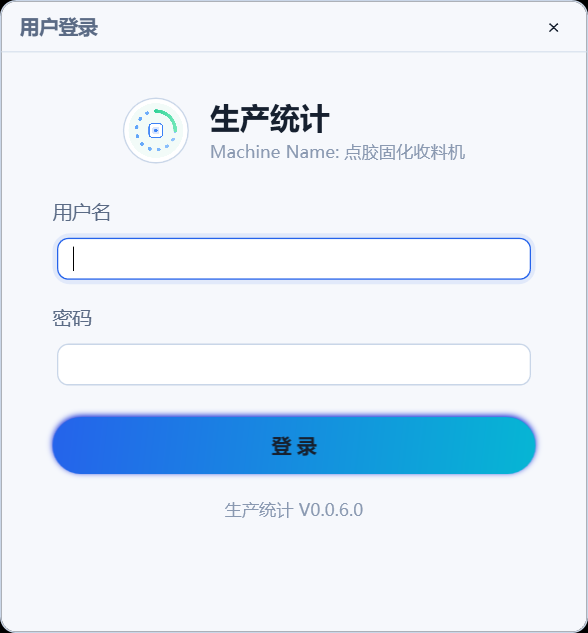
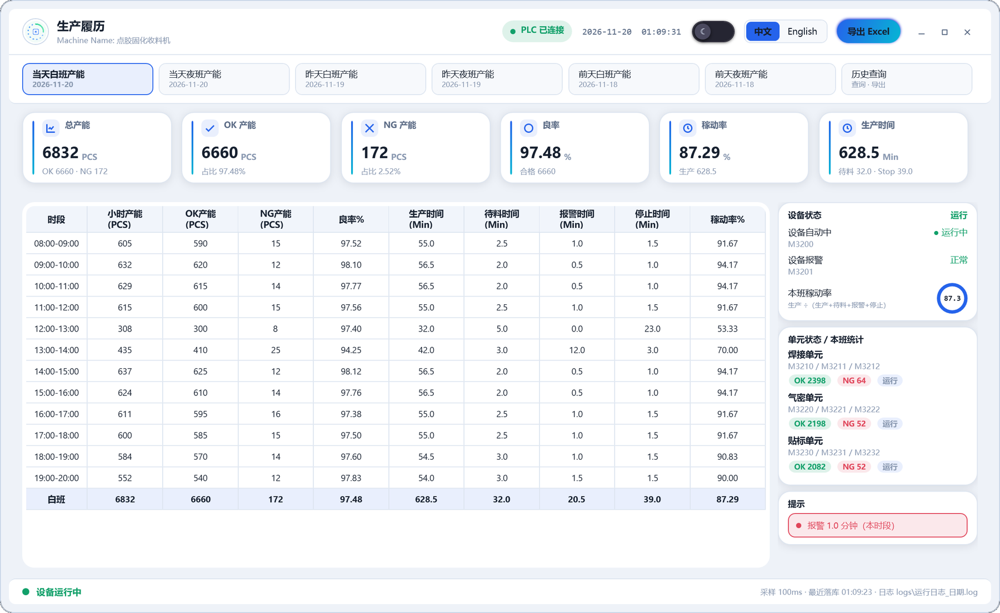
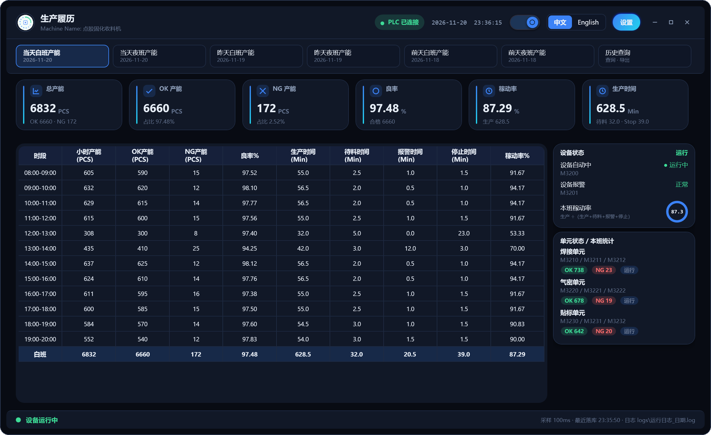
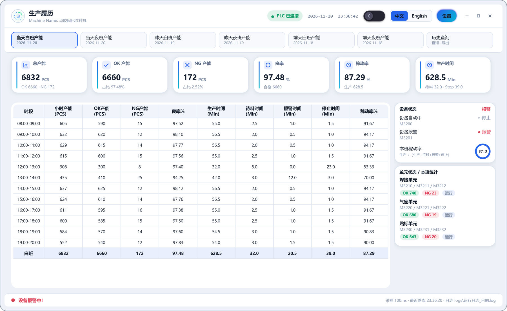
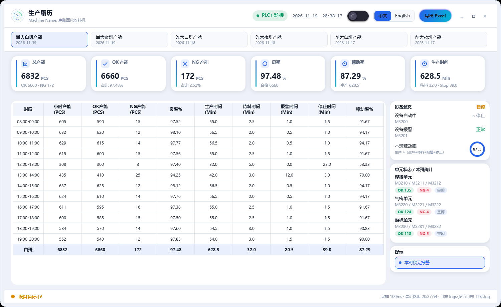
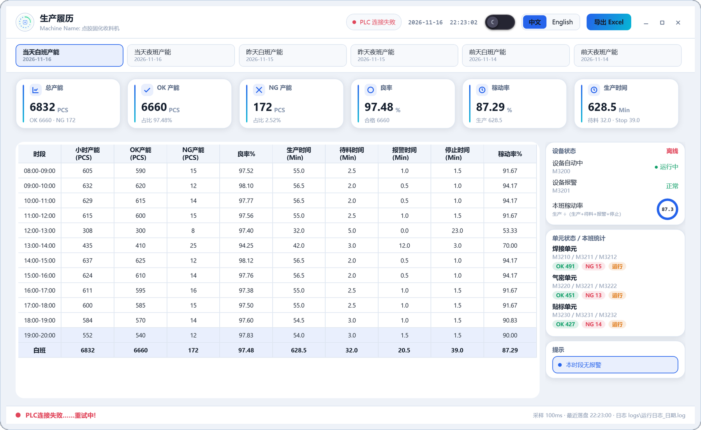
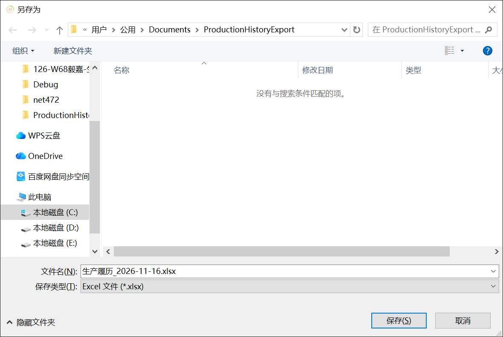
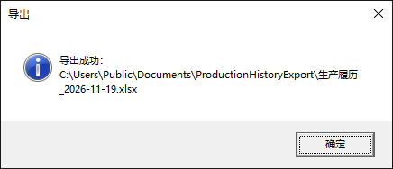

<div align="center">

# 生产统计（点胶固化收料机）

**运行在工控机上的产线生产统计看板——三菱 FX5U 以太网采集 → 三单元 OK·NG 计数 + 班次时间记账 → SQLite 数据库落库 → Excel/CSV 导出，一条龙。**


焊接 / 气密 / 贴标三单元产量与四类时间（生产·待料·报警·停止）实时看板：
当天·昨天·前天 × 白班·夜班 6 页签回看 + 历史查询页（按日期区间/单元筛选、导出 CSV），
数据主存储 SQLite 单文件库（旧版 CSV 首启自动导入），中英双语、深浅主题、按天滚动日志、
自诊断"时间账目/分钟产量"日志让现场排障一眼定位。

</div>

---

## 界面速览

配图均为演示机实拍（假 PLC + 真实采集路径的演示数据），随软件界面迭代同步重拍。

| | |
| --- | --- |
|  |  |
| 登录窗：主界面顶栏「登录」按钮弹出（预置账号 admin），风格与主窗同一套控件族 | 主界面：7 页签看板（6 班次 + 历史查询）+ KPI + 单元状态 + 设备状态条 |
|  |  |
| 深色主题（右上角开关即时切换并写回 ini） | 报警状态：状态条与右栏徽标变红，报警时间进统计 |
|  |  |
| 待料状态：三单元 IDLE 指示与待料时间 | PLC 离线：顶栏/底栏红字提示，自动重连不丢账 |
|  |  |
| Excel 导出：历史查询页签内按查询结果导出（所见即所得） | 导出成功提示 |

## 快速开始

```powershell
# ① 还原 submodule（kaleidoscope 通讯/UI 通用库，位于 extern\kaleidoscope）
git submodule update --init --recursive

# ② 构建
dotnet build ProductionStatistics\ProductionStatistics.csproj -c Debug
# 产物：ProductionStatistics\bin\Debug\net472\ProductionStatistics.Wpf.exe

# ③ 部署运行目录（exe 同目录）
#    HslCommunication.dll / EPPlus.dll / System.Data.SQLite.dll + x64\x86 的 SQLite.Interop.dll
#    / Kaleidoscope.dll / Kaleidoscope.UI.dll（构建自动带出，SQLite 原生互操作按位数子目录探测）
#  + hsl.dat（HSL 商业授权，缺它 PLC 会间歇性"系统授权失败"→ 漏计，见"配置与授权"）
#  + 生产统计.ini（首次运行自动生成缺省配置）
#    注：数据主存储 数据\生产统计.db 首次运行自动建库，发现旧版 CSV 会自动导入

# ④ 端到端自动化回归（计数/存储/登录改动后必跑，含启动免登录 + 顶栏 UIA 登录链路）
powershell -ExecutionPolicy Bypass -File tools\E2ETests\Run-E2ETests.ps1

# ⑤ 主题键契约静态检查（改主题键/库样式/主窗控件键后必跑）
powershell -ExecutionPolicy Bypass -File tools\E2ETests\Run-ThemeContractTests.ps1
```

## 功能特性

- **三单元产量计数**：焊接/气密/贴标各 OK·NG 触发位上升沿计数（自锁位软件自动复位），
  双重去抖（OFF 持续时长确认 + 最小计时间隔）压住"复位-再置位"竞态，同件不重复计、快节拍不漏计；
- **四类时间记账**：生产 / 待料 / 报警 / 停止互斥且完全覆盖，"四类之和 = 墙上时间"每分钟
  写进日志可核对；按真实采样间隔计时（休眠/挂起超 10 秒的段自动丢弃不灌假账）；
- **11 位合并读**：自动中/报警 + 三单元 OK·NG·IDLE 共 11 个位一次报文读回（地址连续时），
  单轮采样周期实测 109ms（老 4 次报文 200~330ms），漏采窗口减半；
- **班次看板**：白班 08:00–20:00 / 夜班 20:00–次日 08:00 固定口径，12 小时行 + 合计行，
  KPI（总产能/OK/NG/良率/稼动率/生产时间）+ 稼动率圆环 + 三单元实时状态；
- **登录窗【V2.4.0，V2.4.1 改为按需弹出】**：软件启动直接进看板（**不登录也能使用**）；
  顶栏"设置"按钮左侧新增"登录"按钮，点击弹登录窗（`ChromeDialogWindow` + 库控件族，
  预置账号 admin/123456，`LoginService` 验证并记日志），登录成功按钮显示"已登录：admin"，
  再点可切换账号；关闭登录窗 = 取消本次登录。无角色/权限分级（单预置账号），
  登录窗只做身份确认；
- **看板自动选班次【V2.4.0】**：启动按当前时刻自动停在"正在进行中"的班次页签
  （8~19 点→当天白班、≥20 点→当天夜班、凌晨→昨天夜班，与时间记账归属口径一致）；
- **6+1 页签**：当天/昨天/前天 × 白/夜班 6 页签跨天自动刷新；第 7 页"历史查询"按日期区间 +
  单元筛选从库取数，结果可导出 **Excel 或 CSV**；顶栏原"导出 Excel"按钮改为"设置"下拉
  （占位菜单，后续挂实际设置功能）；右侧栏"提示"卡已删（与底栏状态条信息重复）；
- **SQLite 数据库主存储**：`数据\生产统计.db` 单文件（WAL 模式断电自恢复），每 30 秒 UPSERT
  落库（最坏丢 30 秒，与旧 CSV 同级可靠），启动载入最近三天续算，重启不断账；库为空时
  自动一次性导入旧版 CSV（升级零手工迁移），此后 CSV 只作历史查询导出格式；
- **Excel / CSV 导出【V2.4.0】**：历史查询面板内一键导出**当前查询结果**（日期/班次/时段 +
  9 数据列共 12 列，所见即所得；Excel 数值列写真正数字可求和筛选，CSV UTF-8 BOM）；
  原按天 27×10 固定格式随顶栏按钮一并下线；
- **中英双语 + 深浅主题**：语言运行中一键切换（CSV/Excel 固定中文格式），主题切换写回 ini；
  颜色/阴影全部走库 `Brush.Shell.*` 语义键 + 动态资源，主题开关/胶囊/状态灯用 `Tag` 语义着色，
  两本主题键集由 `Run-ThemeContractTests.ps1` 静态校验（各 133 键、键集一致）；
- **Kaleidoscope.UI 控件族**：顶栏 / 班次页签 / 语言胶囊 / 主题开关 / 投影卡片 / 图标方块 /
  信息提示框 / 状态灯 / 稼动率圆环 / 细滚动条全部复用库 `Kx*` 键（键契约见
  `extern/kaleidoscope/Kaleidoscope.UI/README.md`），本工程只保留 KPI 卡片外壳与 DataGrid；
- **无边框圆角窗口**：继承库 `ChromeBorderlessWindow` 基类（分层真圆角 + WindowChrome +
  `WM_GETMINMAXINFO` 最大化工作区修正），去系统标题栏、圆角外框、真最大化铺满工作区不盖
  任务栏，窗口按屏幕分辨率自适应（现场 1280×1024 可整窗显示）；
- **滚动日志与自诊断**：按天分文件保留 30 天，ERROR 镜像 `错误日志.txt`；
  `时间账目`（每分钟差额核对）/`本分钟产量`（对照 PLC 侧件数）/
  `自锁位过密/脉冲过窄`告警——现场排障三件套。

## 架构

```mermaid
graph LR
    PLC[三菱 FX5U<br/>MC 3E 帧 TCP]
    LIC[(hsl.dat<br/>HSL 商业授权)]
    INI[(生产统计.ini)]

    subgraph KALE[kaleidoscope（submodule）]
        AUTH[HslAuthorization<br/>授权统一注册]
        UI[Kaleidoscope.UI<br/>控件族 + 键板 + 窗基类]
    end

    subgraph APP[ProductionStatistics.Wpf]
        LOGIN[LoginWindow + LoginService<br/>顶栏"登录"按钮按需弹出（预置 admin）]
        COL[PlcCollector 采集线程<br/>合并读 11 位 / 上升沿计数 / 时间记账]
        STORE[StatisticsStore + StatisticsDbStore<br/>内存统计 + 30 秒 SQLite 落库]
        EXP[ExcelExporter<br/>EPPlus]
        MAIN[MainWindow<br/>1 秒 DispatcherTimer<br/>7 页签（6 班次 + 历史查询）]
    end

    MAIN -.->|顶栏登录按钮弹出| LOGIN
    LOGIN -.->|验证通过 / 切换账号| MAIN
    MAIN -.->|查询结果导出| EXP
    PLC -->|合并读 11 位| COL
    COL -->|写回 false 复位自锁位| PLC
    LIC -.->|读取注册| AUTH
    AUTH -.->|注册| COL
    INI -.->|IP / 端口 / 去抖 / 地址| COL
    INI -.->|语言 / 主题 / 设备名| MAIN

    COL -->|计数 + 四类时间| STORE
    STORE -->|30 秒 UPSERT（WAL）| DB[(数据/生产统计.db<br/>SQLite 主存储)]
    STORE -->|1 秒定时器拉取| MAIN
    MAIN -.->|历史查询 / CSV 导出| DB
    STORE -.->|查询结果行| EXP
    EXP --> XLSX[(xlsx 履历)]
    COL -.->|连接状态事件 + 脏标志| MAIN
    UI -.->|样式注入| MAIN
```

- **线程纪律**：采集线程只写内存 + 置脏标志，**绝不碰界面**；界面全部由 1 秒 DispatcherTimer
  消费刷新；数据锁内禁止网络 IO（复位写 PLC 在锁外做）。
- **连接状态热更**：`PlcCollector.IsPlcOnline` 由采集线程每轮维护；状态翻转时发
  `连接状态已变化` 事件，经 `Dispatcher.BeginInvoke` 即时刷新顶栏胶囊/灯/文字，
  1 秒定时器再无条件兜底对齐——断线/恢复最多 1 秒可见，后台每轮自动重试重连，
  无需重启；离线时段不计入任何一类时间（不灌假账）。ini 配置改完仍需重启生效。
- **计数链路**：读信号（合并读）→ `TriggerDebouncer` 去抖（OFF 持续时长 + 最小间隔双条件）
  → 上升沿计入当前小时桶 → `PlcSignalResetter` 复位自锁位（状态信号不复位）。
  首次采样只作基准不计数（启动残留 ON 不算产量、但必须清掉）。

## 目录结构

```text
ProductionStatistics/                    # 仓库根
├── ProductionStatistics/                # 主工程（WPF，.NET Framework 4.7.2）
│   ├── MainWindow.xaml(.cs)             # 主窗体：7 页签看板（6 班次 + 历史查询）/ KPI / 设置下拉 / 自绘窗口
│   ├── LoginWindow.xaml(.cs)            # 登录窗【V2.4.0】：主窗顶栏"登录"按钮按需弹出（V2.4.1）
│   ├── App.xaml(.cs)                    # 入口：日志初始化 / 异常兜底 / 主题切换 / 直接建主窗（V2.4.1 免登录启动）
│   ├── Services/                        # PlcCollector 采集 / StatisticsStore+StatisticsDbStore 落库 / AppConfig / ExcelExporter
│   ├── Business/                        # TriggerDebouncer 去抖 / PlcSignalResetter 复位 / PlcAddressConfig 地址 / ShiftStore CSV 存取 / Log / LoginService 登录验证
│   ├── ViewModels/ Controls/ Themes/    # 表格行·查询行模型 / 样式 / 两套主题色板
│   └── Resources/                       # exe 图标
├── libs/                                # 第三方二进制依赖（HslCommunication / EPPlus / System.Data.SQLite + x64\x86 原生互操作，必须入库）
├── extern/kaleidoscope/                 # ★ 公司通讯/UI 通用库（git submodule，源码级依赖）
│   ├── Kaleidoscope/                    #   设备通讯库（HslAuthorization 授权 / HslPlcClient 多品牌 PLC / 日志桥）
│   └── Kaleidoscope.UI/                 #   WPF 复用控件库（键板 / Fresh·Kx 控件族 / 圆角窗基类）
├── docs/                                # 三份培训文档（操作员/客户技术/内部版）+ 截图
├── tools/
│   ├── E2ETests/                        # ★ 端到端回归（T8 落库 + T9~T12 启动免登录/顶栏登录/自动选页签）+ 主题键契约静态检查
│   │                                    #   另有 DocShot/shot_window.ps1 轻量窗口截图取证
│   └── DocShot/                         # 文档截图 harness（FakePlc 假 PLC / Invoke-UiaLogin 自动登录 / 核验 / PDF 转换）
├── AGENTS.md                            # AI 协作规范（改代码前必读）
├── CHANGELOG.md                         # 版本改动记录
└── ProductionStatistics.sln
```

## 文档导航

| 文档 | 面向 | 内容 |
| --- | --- | --- |
| [`docs/01_操作员版_生产统计.md`](docs/01_操作员版_生产统计.md) / [PDF](docs/01_操作员版_生产统计.pdf) | 产线操作员、班组长 | 界面、班次、报警、待料、离线、导出、交接班、禁止操作、常见问题 |
| [`docs/02_客户技术工艺版_生产统计.md`](docs/02_客户技术工艺版_生产统计.md) / [PDF](docs/02_客户技术工艺版_生产统计.pdf) | 客户设备/工艺工程师、信息化对接人 | 系统组成、功能边界、统计口径、PLC 地址、参数、数据、排障、验收自查 |
| [`docs/03_内部版_生产统计.md`](docs/03_内部版_生产统计.md) / [PDF](docs/03_内部版_生产统计.pdf) | 我方售后、实施、开发 | 系统全景、源码定位、采集/存储/导出实现、已知缺陷、交付检查单 |
| [`tools/E2ETests/README.md`](tools/E2ETests/README.md) | 开发/测试 | 端到端回归用例表与用法 |

> 三份培训文档与截图由 `tools/DocShot/` 真程序+假 PLC 生成（图注标注「演示数据」），
> 界面改动后重跑 harness 即可整批换图；文档与截图核验：
> `python tools\DocShot\check_config.py --strict` + `python tools\DocShot\check_docs.py`。

## 配置与授权

`生产统计.ini`（UTF-8，程序首次运行自动生成；现场可改，改完重启生效）关键项：

| 键 | 缺省 | 含义 |
| --- | --- | --- |
| `[PLC] IP` / `Port` | 192.168.1.156 / 6060 | PLC 地址与端口 |
| `[PLC] 轮询间隔Ms` | 100 | 采集周期，越小越不易漏短脉冲 |
| `[PLC] 信号确认OFF毫秒` | 300 | 去抖：OFF 持续多久才算"信号真的结束"（实测复位空档 230ms + 30% 余量） |
| `[PLC] 计数最小间隔Ms` | 1500 | 去抖：两次计数最小间隔（自动抬高到 ≥2.5×采样周期） |
| `[PLC地址]` 11 键 | M3200~M3232 | 信号地址现场可改；同前缀且跨度 ≤100 点自动启用合并读 |
| `[PLC地址] 不复位地址` | 空 | 逗号分隔；这些地址读到 ON 不写回 false（默认仅自动中/报警不复位） |
| `[界面] 设备名称 / 设备名称En` | 点胶固化收料机 | 中/英文界面显示名（英文栏别用 `&`，Label 会吃掉） |
| `[界面] 语言` / `主题` | 中文 / 浅色 | 启动语言（运行中切换不写回）与主题（切换写回） |

- **HSL 商业授权（必须）**：`hsl.dat` 放 exe 同目录，程序启动经 kaleidoscope `HslAuthorization`
  自动注册——**缺它 PLC 通讯会间歇性"系统授权失败"，断线时段产量整段漏计**（V2.0.x 现场
  11-18/11-19 事故根因，日志有 `HSL 授权状态` 一行可自查）。`hsl.dat` 是商业机密：
  已入 `.gitignore`，严禁提交仓库、严禁随源码分发，部署新版本必须同步拷贝。
- **班次时间固定**：白班 08:00–20:00、夜班 20:00–次日 08:00，ini 不可改。
- 缺失任何配置文件软件都能启动：缺失项按内置缺省运行并在日志提示。

## 部署与交付

1. 拷贝构建产物：`ProductionStatistics.Wpf.exe` + 同目录全部 DLL
   （`HslCommunication` / `EPPlus` / `System.Data.SQLite` + `x64\`·`x86\` 子目录里的
   `SQLite.Interop.dll`【V2.3.1 必须，缺了启动报"找不到 SQLite.Interop.dll"】 /
   `Kaleidoscope` / `Kaleidoscope.UI` 等，构建输出自动带出）；
2. **拷贝 `hsl.dat`**（授权机密，缺它通讯间歇性失败漏计）；
3. 首次运行自动生成 `生产统计.ini` 缺省配置 → 按 PLC 实际改 IP/端口与信号地址；
   同时自动建库 `数据\生产统计.db`（发现旧版按天 CSV 自动导入，无需手工迁移）；
4. 开机自启（可选）：把 exe 快捷方式放启动文件夹；硬件未就绪时软件显示"离线重试中"并自动补连。

## 注意事项

- **登录账号为出厂预置**（admin/123456，写死在 `LoginService.cs`）：首次部署后建议联系
  我方修改；软件启动不强制登录（顶栏"登录"按钮按需打开），登录窗只做身份确认，
  无角色权限分级——按人限权需二次开发。
- PLC 离线时程序不崩：界面红字提示、每 60 秒日志留痕、恢复后自动续采；
  但**断线时段的触发脉冲无法补采**（PLC 侧自锁位保持 ON，恢复后按"残留基准"处理不补计）——
  长时间离线建议现场核对 PLC 侧实际件数后用历史查询导出人工核对修正。
- 触发位必须是"置位保持型"自锁位（软件读到 ON 会写回 false）；脉冲宽度 < 采样周期的
  置位型信号会触发"脉冲过窄"告警，先调小 `轮询间隔Ms`。
- 双开软件会互相争抢 SQLite 库与旧 CSV（无单实例保护），现场禁止双开。
- 数据库文件（`数据\生产统计.db` + 同名 `-wal`/`-shm`）与日志同在 exe 目录"数据/logs"下，
  备份现场数据时**连 `-wal` 文件一起拷**（或在软件关闭后只拷主库文件）。
- 图示界面为演示机 Mock 数据；涉及授权码、客户真实生产数据的截图在对外交付文档中一律打码。
