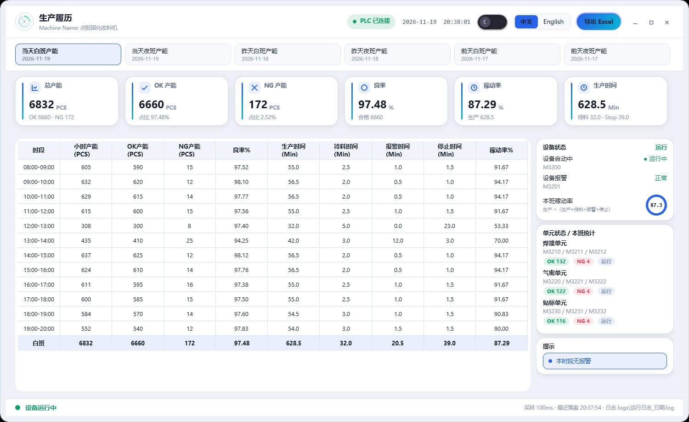
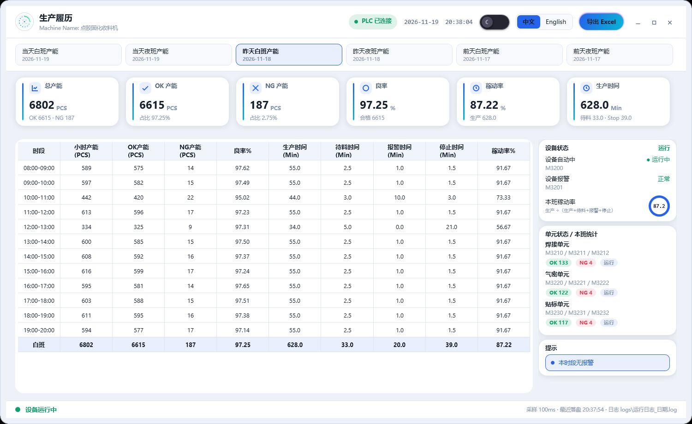
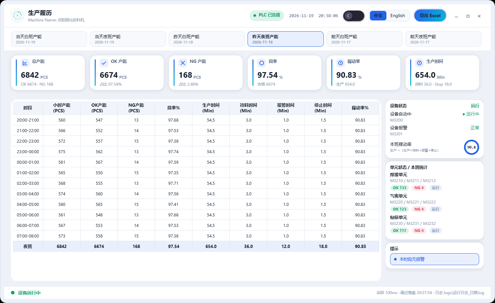
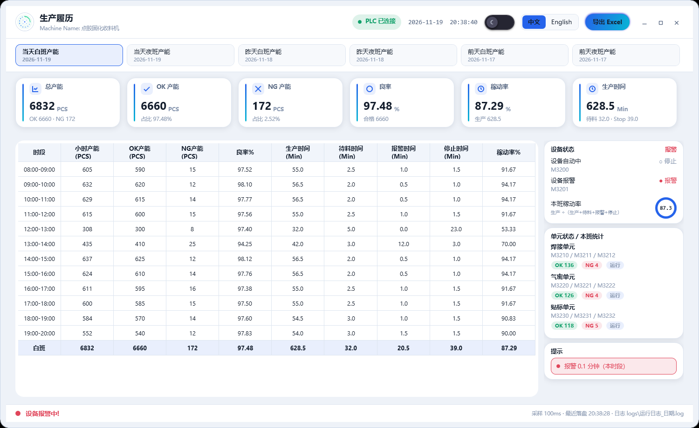
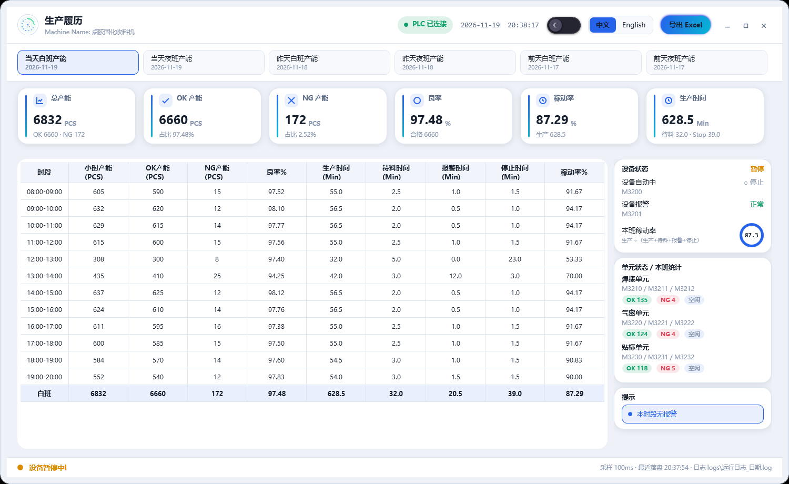
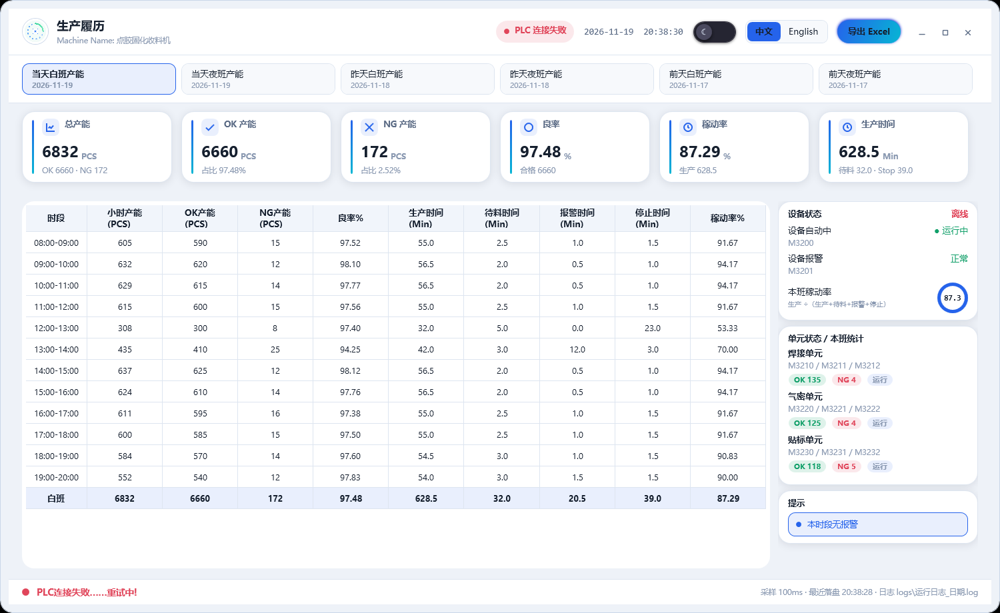
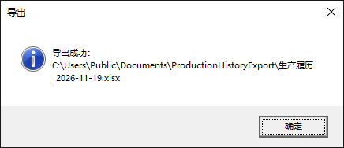
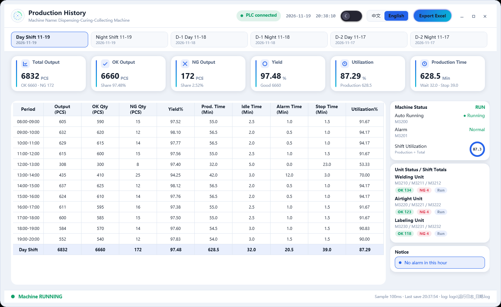
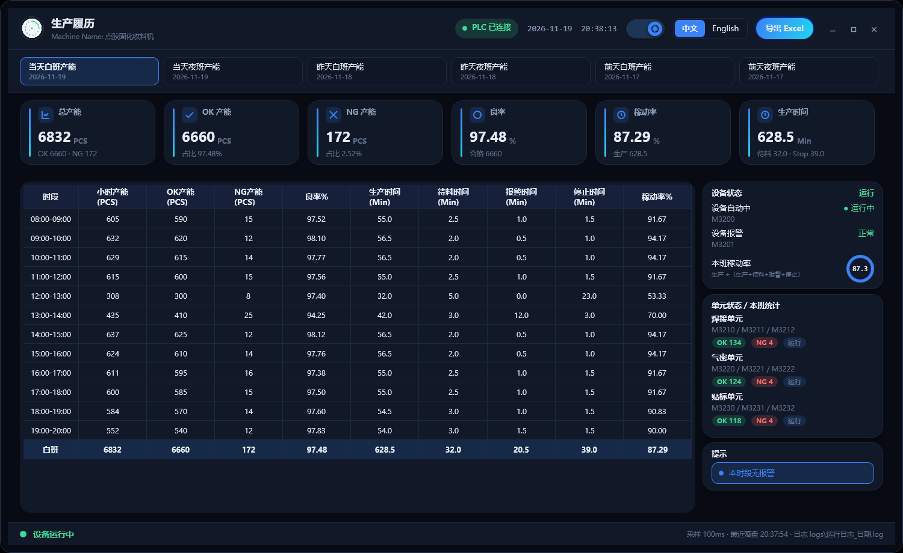

# 生产统计 · 操作员版

> 适用对象：产线操作员、班组长  
> 适用设备：点胶固化收料机（三菱 FX5U）  
> 软件版本：0.0.2  
> 文档版本：2026-11-16

## 一、这台设备是做什么的

这套软件装在收料机旁边的工控机上，负责把三个单元的生产情况自动记下来：

| 单元 | 记什么 | 现场看什么 |
| --- | --- | --- |
| 焊接单元 | OK、NG 件数 | 焊得好不好、有没有漏焊 |
| 气密单元 | OK、NG 件数 | 气密检测合不合格 |
| 贴标单元 | OK、NG 件数 | 标签贴没贴、贴没贴正 |

软件按**小时**和**班次**把三个单元的数字汇总，同时记录四类时间：生产、待料、报警、停止。您不需要手工抄表，只要会看界面、会处理报警和离线、会导出 Excel 就够了。

软件每 30 秒自动把数据存到电脑硬盘的 `数据` 文件夹里。就算电脑突然断电，最多丢最近 30 秒的计数；重新开机后，软件会把今天、昨天、前天的数据读回来，接着往下记。

## 二、开机前检查

每天开机按下面顺序做，一步都不要跳：

1. **看硬件**：PLC 电源灯亮、网线插紧、工控机开机。
2. **双击桌面图标**「生产统计」，等待主界面出现。
3. **看顶栏**：应显示绿色的「PLC 已连接」。如果是红色「PLC 连接失败」，先不要生产，按第七章处理。
4. **看底栏**：应显示「采样 100ms · 最近落盘 HH:mm:ss」，落盘时间会每 30 秒更新一次。
5. **看右栏**：设备状态、三个单元的 OK/NG、提示卡都应正常显示。
6. **只开一个窗口**：任务栏里只能有一个「生产统计」，开两个会互相覆盖数据（详见第十一章）。

> 注意：软件启动后默认选中「当天白班」。如果您在夜班开机，左表显示的是当天白班的历史数据，右栏显示的才是当前夜班的实时统计——这是正常的，第四章会解释。
## 三、界面一眼看懂

*图 1 主界面全貌（演示数据）*

### 3.1 顶栏

从左到右依次是：软件图标、设备名「点胶固化收料机」、PLC 连接状态灯、当前日期时间、主题切换按钮、中英文切换、蓝色的「导出 Excel」按钮。

- **PLC 已连接**：绿色，表示通讯正常。
- **PLC 连接失败**：红色，表示读不到 PLC，按第七章处理。
- 时间显示的是工控机的系统时间，请勿随意修改。

### 3.2 六个页签

页签排成两行，第一行是日期，第二行是班次：

| 页签 | 含义 |
| --- | --- |
| 当天白班产能 | 今天 08:00–20:00 |
| 当天夜班产能 | 今天 20:00–次日 08:00 |
| 昨天白班产能 | 昨天 08:00–20:00 |
| 昨天夜班产能 | 昨天 20:00–次日 08:00 |
| 前天白班产能 | 前天 08:00–20:00 |
| 前天夜班产能 | 前天 20:00–次日 08:00 |

页签上的日期每天自动更新，不需要手工改。

### 3.3 六张 KPI 卡

从左到右分别是：总产能、OK 产能、NG 产能、良率、稼动率、生产时间。这里的数字都是**当前选中页签那一班**的合计，不是全天的。

- 总产能 = OK + NG。
- 良率 = OK ÷ 总产能 × 100%。
- 稼动率 = 生产时间 ÷（生产 + 待料 + 报警 + 停止）× 100%。
- 生产时间只统计「设备自动中」信号为 ON 的时间。

### 3.4 小时表

中间的大表每班固定 12 行，每行一个小时，最后一行是「白班合计」或「夜班合计」。列的含义：

| 列 | 含义 |
| --- | --- |
| 时段 | 例如 08:00–09:00 |
| 小时产能(PCS) | 这一小时 OK + NG |
| OK 产能 / NG 产能 | 这一小时合格 / 不合格件数 |
| 良率% | 这一小时 OK ÷ 小时产能 |
| 生产 / 待料 / 报警 / 停止时间(Min) | 这一小时四类时间，保留 1 位小数 |
| 稼动率% | 这一小时生产时间占四类时间总和的比例 |

### 3.5 右侧状态栏

右栏从上到下是：设备状态（自动中 / 报警 / 本班稼动率圆环）、单元状态 / 本班统计、提示。

**请特别注意**：右栏的「本班统计」和「提示」永远按**电脑当前时间所在的班次和小时**计算，不会跟着页签变。您点开「昨天白班」，左表是昨天白班，右栏仍是今天当前班次。这是软件的设计，不是故障。

### 3.6 底栏

底栏显示设备四态之一：**设备运行中**（绿）、**设备暂停中!**（黄）、**设备报警中!**（红）、**PLC连接失败……重试中!**（红）。右侧显示采样周期和最近落盘时间。
## 四、班次和页签怎么用

### 4.1 班次时间

软件固定两个班次，ini 里改不了：

- **白班**：08:00–20:00，共 12 个小时。
- **夜班**：20:00–次日 08:00，共 12 个小时。

夜班跨过午夜，但整班都算在**开班那天**。例如 11 月 16 日 20:00 到 11 月 17 日 08:00，算「11 月 16 日夜班」。凌晨 00:00–08:00 的产量也记在 11 月 16 日这张表里，不会跑到 17 日。

### 4.2 看历史班次

点「昨天白班产能」，左表、KPI 卡都会切换成昨天白班的数据：

*图 2 查看昨天白班（演示数据）*

点「昨天夜班产能」，可以看到跨午夜后的 00:00–08:00 行：

*图 3 查看昨天夜班（演示数据）*

请注意图 2、图 3 的右栏：无论点哪个页签，右栏显示的「本班统计」都是**截图时电脑当前班次**的数字，所以它和左表对不上。这是正常的。要核对历史班次，只看左表和 KPI 卡。

### 4.3 页签上没数据怎么办

如果某个页签整张表都是 0，先确认：

1. 这个班次是否真的生产过；
2. 当时软件是否开着、PLC 是否连接；
3. 是否有人删过 `数据` 文件夹里的 CSV。

软件只自动载入今天、昨天、前天三天的数据。更早的班次请查导出的 Excel 或备份的 CSV。

## 五、报警怎么看、怎么处理

报警信号来自 PLC 的「设备报警」位。软件只读这个信号，不会替您复位报警。

*图 4 设备报警（演示数据）*

报警发生时，界面会有三处变化：

1. 底栏变红，显示「设备报警中!」，右侧徽标显示「报警」。
2. 右栏「设备报警」变成红色的「● 报警」。
3. 提示卡变红，显示「报警 X.X 分钟（本时段）」。

处理顺序：

1. **先看设备**：HMI 报警内容、三色灯、是否有异响/卡料/缺气。
2. **按现场规程处理**：能自行处理的按操作手册处理；处理不了立即叫班长或保全。
3. **记录起止时间**：交接班本上写清几点几分报警、几点几分恢复。
4. **恢复后确认**：底栏回到「设备运行中」，右栏「设备报警」回到绿色「正常」，提示卡回到「本时段无报警」。

报警时间会按小时累计。如果报警跨小时，会分别记到对应小时；跨班次则分别记到两个班。

> 不要为了“让报警消失”去拔 PLC 电源或关软件。关软件只会让这段时间变成离线、不计数，问题还在设备上。
## 六、待料怎么看

「待料」不是故障，是设备在等上游来料。判断依据是三个单元任意一个的 IDLE 信号为 ON。

*图 5 待料状态（演示数据）*

界面表现：

- 底栏变黄，显示「设备暂停中!」，徽标显示「暂停」。
- 右栏三个单元的状态显示「空闲」。
- 待料时间会累计到当前小时的「待料时间(Min)」。

处理顺序：

1. 看上游供料是否断料、缺料、卡料。
2. 看物料是否用错、方向是否反、料盘是否空。
3. 处理后等待设备自动恢复；IDLE 灭掉后，单元状态回到「运行」，底栏回到「设备运行中」。

请注意：**设备暂停不一定都是待料**。如果底栏是黄色「设备暂停中!」，但三个单元都没有显示「空闲」，说明设备既不在自动运行、也没有 IDLE 信号，属于「停止」。停止时间也会累计，常见原因是操作员按了暂停、安全门打开、设备处于手动模式。请按现场规程确认。

## 七、离线怎么办

离线就是软件读不到 PLC。此时软件不会计数、不会累计任何时间，也不会在恢复后补记。

*图 6 PLC 离线（演示数据）*

界面表现：

- 顶栏红色「PLC 连接失败」。
- 底栏红色「PLC连接失败……重试中!」，徽标「离线」。
- 右栏提示卡显示「PLC连接失败……重试中」。
- 三个单元保留离线前最后一次的「运行/空闲」状态，不再变化。

排查顺序（从易到难）：

1. **看网线**：工控机网口灯是否亮，网线是否松动、被压、被踩。
2. **看 PLC**：电源灯、RUN 灯是否正常，是否有人断电或按了急停。
3. **看 IP**：工控机与 PLC 是否在同一网段；`生产统计.ini` 里的 IP 是否为 `192.168.1.156`（以现场实际为准）。
4. **看电脑**：是否有人改了网络设置、插了其他网卡、开了 VPN。
5. **重启软件**：前四步都正常仍连不上，关掉软件再打开一次。

离线超过 5 分钟，请通知保全或我方售后，并在交接班记录上写清**离线起止时间**。离线期间的生产数量需要现场另行补记，软件不会自动补。
## 八、导出 Excel

### 8.1 导出步骤

1. 先用页签选中要导出的**日期**（白班/夜班都一样，导出的是这一天的完整两班）。
2. 点右上角蓝色的「导出 Excel」。
3. 在保存对话框里选一个自己找得到的文件夹，文件名默认是「生产履历_日期.xlsx」，一般不用改。
4. 点「保存」，等待「导出成功」提示。

*图 7 导出成功提示（演示数据）*

点「确定」关闭提示即可。导出的是**整天白班 + 夜班**的完整履历，不是当前页签那一班。例如选中「昨天夜班」再导出，文件里仍然包含昨天白班和昨天夜班两部分。

### 8.2 导出文件里有什么

Excel 第一行是标题（设备名 + 日期），第三行是表头，之后是：

- 白班 12 个小时行；
- 白班合计行；
- 夜班 12 个小时行；
- 夜班合计行。

列与界面一致，另外 Excel 里还会算出每小时的良率和稼动率。电脑不需要装 Office 也能导出；查看文件时需要 Excel 或 WPS。

### 8.3 导出注意

- 导出不会影响正在运行的统计，也不会清空数据。
- 如果提示「导出失败」，先看目标文件是不是正被 Excel 打开；关掉再导一次。
- 不要为了“整理数据”去直接改 `数据` 文件夹里的 CSV。软件每 30 秒会整文件覆盖一次，手改的内容会被冲掉；要整理请导成 Excel 再改。

## 九、语言和主题

### 9.1 中英文切换

点顶栏的「中文 / English」按钮即可切换。英文界面适合外籍工程师或客户参观时使用：

*图 8 英文界面（演示数据）*

请注意：**语言只影响屏幕显示**。CSV 文件、Excel 文件的列名和内容仍是中文，不会变成英文。运行中切换语言不会写回配置文件，下次启动仍按 ini 里的「语言=中文」显示。

### 9.2 深浅主题

点顶栏的太阳/月亮图标切换深色、浅色主题：

*图 9 深色主题（演示数据）*

主题切换会记到 `生产统计.ini` 里，下次启动沿用上次的选择。语言不会记，这是两者的区别。
## 十、交接班怎么做

交接班时按下面五项核对，最多两分钟：

1. **看当前班总数**：选中当前班页签，记下总产能、OK、NG、良率。
2. **看异常时间**：记下报警、待料、停止时间，尤其是报警时长。
3. **看是否离线**：问清本班有没有出现「PLC 连接失败」，起止时间是多少。
4. **看落盘时间**：底栏「最近落盘」应该是 30 秒以内的时刻。如果停在很久以前，说明软件可能卡住或数据目录写不进去，立即叫人。
5. **写交接班记录**：把上述数字和异常写进本子，不要只口头交接。

> 注意：软件默认选中「当天白班」。夜班交接时，请先点「当天夜班产能」，不要拿白班的数字交接。

## 十一、禁止操作

下面这些操作会直接造成数据错误或丢失，请务必避免：

| 禁止操作 | 后果 |
| --- | --- |
| 同时开两个「生产统计」窗口 | 两个进程各自记数、各自覆盖同一个 CSV，数据会互相冲掉 |
| 用任务管理器强行结束进程 | 可能丢掉最近 30 秒的计数；尽量点右上角关闭 |
| 直接编辑 `数据` 文件夹里的 CSV | 30 秒后会被软件覆盖；格式改错还会让当天数据读不回来 |
| 未经指导修改 `生产统计.ini` | IP、地址、去抖参数改错会导致连不上或计数异常 |
| 修改电脑系统时间 | 班次和小时归属会错乱，历史数据可能被写到错误的日期 |
| 生产运行中拔网线、关 PLC 电源 | 软件进入离线，这段时间不计数、不补记 |
| 运行时删除 `logs` 或 `数据` 文件夹 | 日志丢失、历史数据无法续算 |
| 把软件装到 U 盘或网络共享盘运行 | 路径变化、权限不足、断网都会导致数据写不进去 |

## 十二、常见问题

| 现象 | 可能原因 | 怎么办 |
| --- | --- | --- |
| 顶栏红色「PLC 连接失败」 | 网线、PLC 电源、IP 不对 | 按第七章顺序排查；5 分钟不好转告保全 |
| 底栏「设备暂停中!」但没显示空闲 | 手动模式、安全门、按了暂停 | 按现场规程确认，不要直接重启软件 |
| 三个单元都不计数 | 触发地址错、脉冲太窄、PLC 没给信号 | 看右栏 OK/NG 是否变化；不变就叫我方 |
| 计数一直增加 | 触发位地址配错、信号抖动 | 记下时间和单元，通知我方查地址与去抖参数 |
| 某个页签全是 0 | 那天没生产、软件没开、CSV 被删 | 查交接班记录和备份 |
| 导出的文件打不开 | 文件被占用、扩展名被改 | 关掉 Excel 重导；不要改扩展名 |
| 界面文字变英文了 | 有人点了语言按钮 | 点「中文」切回来；重启也会回中文 |
| 深色/浅色变了 | 有人点了主题按钮 | 再点一次切回；主题会记住 |
| 底栏落盘时间不更新 | 数据目录不可写、磁盘满 | 检查磁盘空间和 `数据` 文件夹权限，叫我方 |

## 十三、名词解释

| 名词 | 意思 |
| --- | --- |
| OK / NG | 合格品 / 不合格品 |
| 总产能 | OK + NG |
| 良率 | OK ÷ 总产能 |
| 稼动率 | 生产时间 ÷ 四类时间总和 |
| 生产时间 | 设备「自动中」信号为 ON 的时间 |
| 待料时间 | 设备不在自动中、但任一单元 IDLE 信号为 ON 的时间 |
| 报警时间 | 设备报警信号为 ON 的时间 |
| 停止时间 | 以上三类都不成立的时间（手动、暂停、安全门等） |
| 落盘 | 软件把内存里的统计写进硬盘 CSV |
| 离线 | 软件读不到 PLC，顶栏和底栏显示连接失败 |

---

> 本文所有截图均为演示数据，设备名、日期、产量数字仅用于说明界面，不代表现场实际生产结果。  
> 现场遇到本文没写到的情况，请先记录“时间、现象、界面提示”，再联系班长或我方售后。
