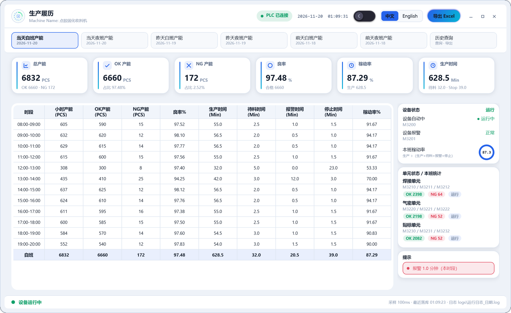
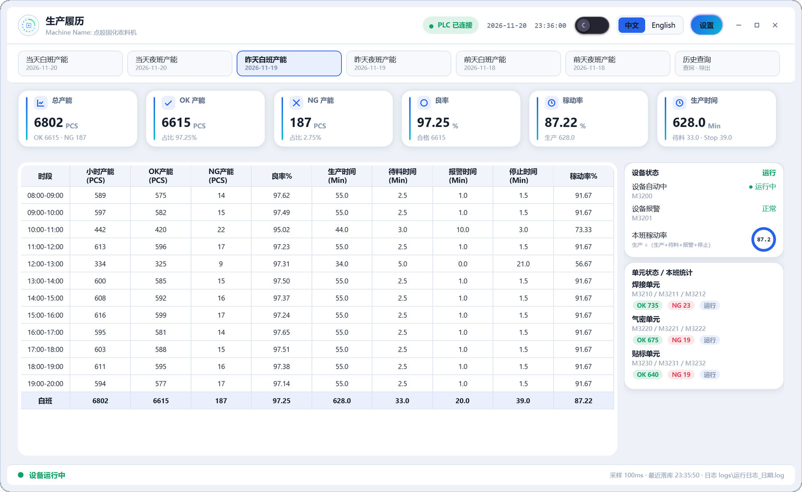
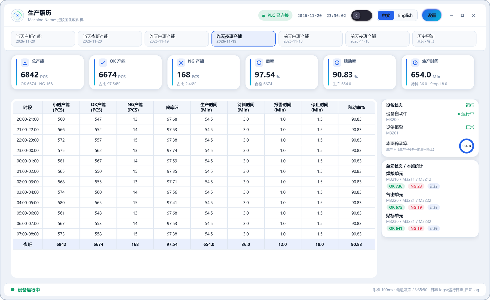
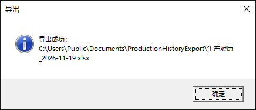
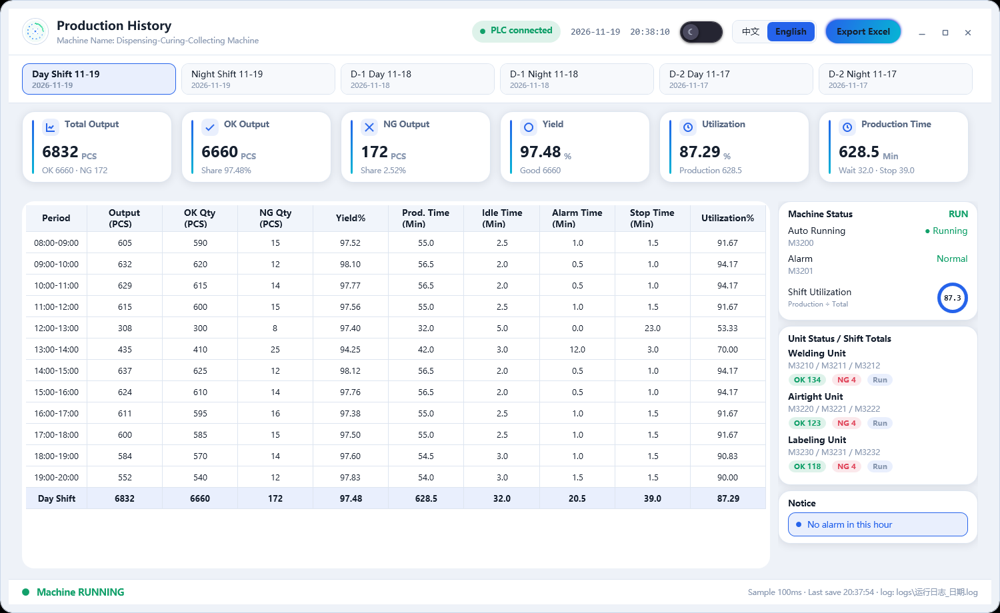
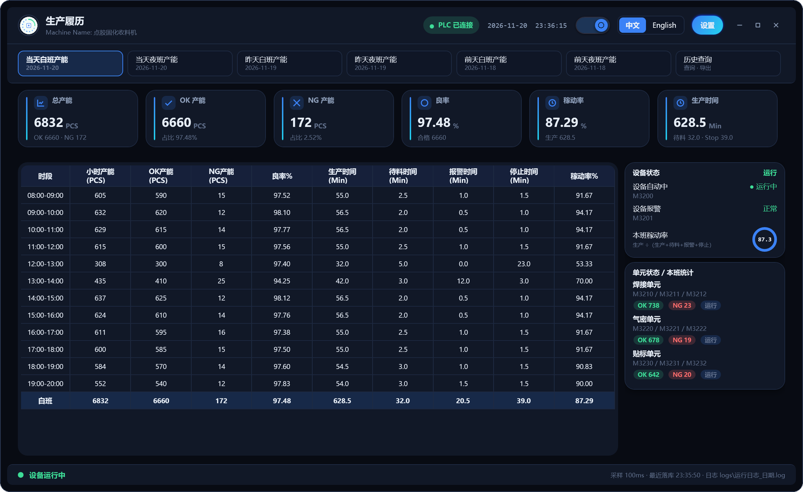

# 生产统计 · 客户技术工艺版

> 适用对象：客户设备工程师、工艺工程师、信息化对接人  
> 适用设备：点胶固化收料机（三菱 FX5U）  
> 软件版本：0.0.3  
> 文档版本：2026-11-16

## 一、系统组成与交付边界

### 1.1 系统组成

这套「生产统计」是一套**单机看板软件**：工控机通过以太网读取三菱 FX5U 的产量与状态信号，在本地完成计数、时间累计、CSV 落盘和 Excel 导出。它不依赖服务器，也不依赖外网。

| 组成部分 | 现场配置 | 说明 |
| --- | --- | --- |
| 工控机 | Windows 10 / 11，.NET Framework 4.7.2 | 软件运行环境，建议 8 GB 内存以上 |
| 显示器 | 1280×1024 及以上 | 主界面按屏幕自动适配，推荐 1920×1080 |
| PLC | 三菱 FX5U | MC 协议 3E 帧、二进制、TCP，默认端口 6060 |
| 网络 | 工控机与 PLC 有线直连或同一交换机 | 建议双方都配固定 IP |
| 数据文件 | 软件目录下 `数据\生产履历_日期.csv` | 每 30 秒整文件覆盖一次 |
| 运行日志 | 软件目录下 `logs\运行日志_日期.log` | 按天分文件，保留 30 天 |
| Excel 导出 | `.xlsx`，由软件内置组件生成 | 导出电脑不需要安装 Office |

### 1.2 功能边界

下表是交付版本的**实际能力**，请按此规划工艺与信息化对接，避免把需求建立在不存在的能力上：

| 能力 | 是否具备 | 说明 |
| --- | --- | --- |
| PLC 实时采集 | 具备 | 默认 100 ms 轮询，可在 ini 调整 |
| 三单元 OK / NG 计数 | 具备 | 焊接、气密、贴标各自独立 |
| 生产 / 待料 / 报警 / 停止时间 | 具备 | 按小时累计，保留 1 位小数 |
| 今天 / 昨天 / 前天共 6 个班次回看 | 具备 | 白班、夜班分开 |
| Excel 导出整天履历 | 具备 | 白班 + 夜班，含两行合计 |
| 中英文界面、深浅主题 | 具备 | 语言运行中切换，主题记忆 |
| 账号、用户权限、授权 | 无 | 本软件没有登录与权限体系 |
| MES 对接 | 不支持 | 无接口、无消息队列、无上位机通讯 |
| 配方管理 | 无 | 不保存、不下发工艺配方 |
| 数据库 | 不使用 | 数据只存 CSV 文件 |
| 相机、光源、视觉检测 | 未配置 | 现场没有这类硬件，软件也不采集 |
| 扫码枪、条码追溯 | 未配置 | 不做单件追溯 |
| OEE、SPC 分析 | 不提供 | 只做产量与四类时间统计 |
| 云平台、远程监控 | 不具备 | 数据不出工控机 |
| 邮件报表 | 不提供 | 需要时人工导出 Excel 外发 |
| 多品牌 PLC | 不支持 | 当前只适配三菱 MC 协议 |

> 如果后续需要 MES 对接、配方下发、单件追溯或 OEE，属于**二次开发范围**，需要另行评估接口、数据结构和验收标准。

### 1.3 交付物

| 交付物 | 位置 | 用途 |
| --- | --- | --- |
| 主程序 | `ProductionStatistics.Wpf.exe` | 双击运行，无需安装 |
| 配置文件 | `生产统计.ini` | PLC 地址、界面语言、主题、去抖参数 |
| 依赖库 | 随软件附带的运行库（2 个 DLL） | 与 exe 同目录，不能删 |
| 数据目录 | `数据\` | 自动生成，存放按日 CSV |
| 日志目录 | `logs\` | 自动生成，存放运行日志 |
| 培训文档 | 本文件及操作员版 | 交付培训用 |
## 二、权限与账号现状

### 2.1 实际情况

本软件**没有登录界面、没有用户账号、没有角色划分、没有授权码**。任何能操作这台工控机的人，打开软件后都可以：

- 查看三个单元和六个班次的全部数据；
- 切换语言、主题、页签；
- 导出任意一天的 Excel；
- 通过文件系统修改 `生产统计.ini`、删除 `数据` 或 `logs` 目录。

软件内部也没有「管理员 / 操作员」之分，不存在按角色隐藏的页面或功能。这一点请在做信息安全评估时如实记录，不要按“有权限体系”去设计管理流程。

### 2.2 风险与建议措施

| 风险 | 后果 | 建议措施 |
| --- | --- | --- |
| 非授权人员改 ini | IP、地址、去抖参数被改，采集异常 | 给 `生产统计.ini` 设 NTFS 只读（Administrators 可写） |
| 同时开两个软件 | 两个进程互相覆盖同一 CSV | 现场只保留一个窗口；用 Windows 账户限制多人同时登录 |
| 误删数据目录 | 历史无法续算 | 每日备份 `数据`；目录权限只给运行账户 |
| 误改系统时间 | 班次、小时归属错乱 | 关闭普通账户修改时间的权限；启用 NTP 对时 |
| 导出文件外带 | 生产数据泄露 | 用 Windows 账户与 U 盘管控；导出目录纳入备份/审计范围 |

需要说明：软件自带的 `logs` 只记录**程序运行行为**（启动、连接、落盘、异常），不是按人记录的操作审计日志。它不能回答“是谁点了导出”，只能回答“软件当时在做什么”。

## 三、界面与数据口径

### 3.1 界面分区



*图 1 主界面（演示数据）*

| 区域 | 内容 | 数据范围 |
| --- | --- | --- |
| 顶栏 | 设备名、PLC 连接状态、时钟、主题、中英文、导出 | 全局 |
| 页签 | 当天/昨天/前天 × 白班/夜班 | 选中页签决定左表与 KPI |
| KPI 卡 | 总产能、OK、NG、良率、稼动率、生产时间 | 选中页签那一班 |
| 主表 | 12 个小时行 + 班次合计行 | 选中页签那一班 |
| 右栏 | 设备状态、三单元本班 OK/NG/IDLE、提示 | **当前时间**所在班次与小时 |
| 底栏 | 运行/暂停/报警/离线四态、采样周期、最近落盘 | 实时 |

**右栏与页签不同步**是这套软件的固定设计：左表用于回看历史，右栏用于看“现在”。做工艺分析时，历史数据只看左表和 KPI；右栏只用于判断当前设备状态。

### 3.2 六张 KPI 的口径

| KPI | 计算方式 | 说明 |
| --- | --- | --- |
| 总产能 | OK + NG | 三单元合计，单位 PCS |
| OK 产能 | 三单元 OK 之和 | 合格件数 |
| NG 产能 | 三单元 NG 之和 | 不合格件数 |
| 良率 | OK ÷ 总产能 × 100% | 总产能为 0 时显示 0 |
| 稼动率 | 生产时间 ÷（生产+待料+报警+停止）× 100% | 四类时间总和为 0 时显示 0 |
| 生产时间 | 「设备自动中」为 ON 的累计时间 | 单位分钟，保留 1 位小数 |

主表每一行也按同一公式计算该小时的良率与稼动率。合计行先累加秒数，再换算成分钟，避免逐行四舍五入造成累计误差。

### 3.3 数值显示约定

- 计数：整数，单位 PCS。
- 时间：分钟，保留 1 位小数（内部按秒累计）。
- 良率、稼动率：百分比，保留 2 位小数。
- CSV 与 Excel 中的小数点固定为 `.`，不受 Windows 区域语言影响。
- 界面语言切到英文时，CSV/Excel 的列名仍是中文。
## 四、班次归属与跨天规则

### 4.1 班次定义

| 班次 | 时间范围 | 归属日期 | 小时行数 |
| --- | --- | --- | --- |
| 白班 | 08:00–20:00 | 当天 | 12 |
| 夜班 | 20:00–次日 08:00 | 20:00 所在日期 | 12 |

夜班跨午夜，但整班都算开班那天。例如 11 月 16 日 20:00 到 11 月 17 日 08:00，全部记入「11 月 16 日夜班」。系统日期切到 17 日 00:00 后，采集线程仍把数据写入 16 日的夜班桶，不会新建 17 日白班记录。

### 4.2 小时下标映射

界面和 CSV 都按固定顺序排列，不按文字匹配：

| 班次 | 第 1 行 | … | 第 5 行 | … | 第 12 行 |
| --- | --- | --- | --- | --- | --- |
| 白班 | 08:00–09:00 | … | 12:00–13:00 | … | 19:00–20:00 |
| 夜班 | 20:00–21:00 | … | 00:00–01:00 | … | 07:00–08:00 |

夜班第 5 行是次日 00:00–01:00，第 12 行是次日 07:00–08:00。做数据抽取时请按行序解析，不要用“时段”文字做关键字匹配——现场如果手工改过 CSV 的时段文字，文字可能对不上，但行序仍然可信。

### 4.3 回看历史班次



*图 2 查看昨天白班（演示数据）*



*图 3 查看昨天夜班（演示数据）*

对比图 2、图 3 的右栏可以看到：左表已经切到历史班次，右栏仍显示截图当时的班次统计。这不是数据错位。判断历史数据只看左表和 KPI 卡；右栏用于看当前设备状态。

## 五、统计口径

### 5.1 四类时间的判定优先级

每一段采样时间只会落入一类，判定顺序固定为：

| 优先级 | 条件 | 计入 | 说明 |
| --- | --- | --- | --- |
| 1 | 设备报警 = ON | 报警时间 | 报警优先于运行、待料、停止 |
| 2 | 设备自动中 = ON | 生产时间 | 设备处于自动运行 |
| 3 | 任一单元 IDLE = ON | 待料时间 | 非自动中，且至少一个单元在等料 |
| 4 | 以上都不成立 | 停止时间 | 手动、暂停、安全门等 |

这套优先级保证四类时间**互斥且完全覆盖**（离线期间除外），因此有一个可验收的等式：

> 生产时间 + 待料时间 + 报警时间 + 停止时间 ≈ 该小时墙上经过的时间

如果四类之和明显小于墙上时间，优先怀疑：PLC 离线、电脑休眠、软件被挂起、采样间隔异常。软件日志里的「时间账目」会打印差额，可直接核对。

### 5.2 时间是怎么累计的

- 采集线程用单调时钟测量**两次成功采样之间的真实间隔**，按真实间隔累加，不是按名义轮询周期估算。
- 单次间隔超过 10 秒（电脑休眠、进程被挂起、严重卡顿），这一段整段丢弃，不灌进任何小时桶，并写一条 WARN 日志。
- PLC 读取失败时，该轮不计入任何一类；恢复连接后重新开始计时，不会把离线时段补记成“停止”。
- 报警跨小时会分别记到两个小时的桶；跨班次会分别记到两个班。

### 5.3 产量计数口径

- 每个单元的 OK、NG 各有一个 PLC 触发位，软件检测**上升沿**计数：上一轮 OFF、这一轮 ON，才加 1。
- 启动后的第一次成功采样只作为基准，不计产量，避免把 PLC 残留的 ON 当成一件新产品。
- 触发位是自锁位时，软件读到 ON 并计完数后会把该位写回 OFF，等待 PLC 下一次置位。
- 同一触发位两次计数之间有最小时间间隔（默认 1500 ms，且自动不小于 2.5 倍实际采样周期），用于压住复位后 PLC 快速重置位造成的重复计数。
- 信号必须连续读到 OFF 达到设定轮数（默认 2 轮），才认为“上一件真的结束”，之后的 ON 才算新的一件。

### 5.4 几个容易误解的口径

| 现象 | 口径解释 |
| --- | --- |
| 报警时设备还在自动运行 | 报警优先，这段时间记报警，不记生产 |
| 三个单元都 IDLE，但设备自动中 | 自动中优先，记生产，不记待料 |
| 设备暂停但没有任何 IDLE | 记停止，不记待料 |
| 离线了一段时间 | 四类都不记，恢复后不补 |
| 跨午夜后看“当天夜班” | 仍属于前一天 20:00 开班的那一班 |
| 合计行的时间小于 12 小时 | 可能离线、休眠，或当班尚未结束 |
## 六、PLC 接口

### 6.1 通讯参数

| 项目 | 现场值 | 说明 |
| --- | --- | --- |
| PLC 品牌 / 型号 | 三菱 FX5U | 当前只适配三菱 MC 协议 |
| 协议 | MC 协议 3E 帧、二进制 | 不使用 1E/4E 帧 |
| 传输层 | TCP | 默认端口 6060 |
| PLC IP | 192.168.1.156 | 以现场实际为准，在 ini 的 `[PLC]` 段配置 |
| 连接 / 读取超时 | 2 秒 | 断线时不会长时间阻塞轮询 |
| 轮询间隔 | 100 ms | ini 可调，建议 50–200 ms |

建议工控机与 PLC 使用独立网段或独立交换机，不要和办公网、无线网混在一起。现场若有多台设备，请给每台 PLC 规划固定 IP，避免 DHCP 续租后地址变化。

### 6.2 信号地址表

软件从 `生产统计.ini` 的 `[PLC地址]` 段读取以下 11 个点位，改完重启软件生效：

| 信号键 | 默认地址 | 类型 | 方向 | 含义 |
| --- | --- | --- | --- | --- |
| 设备自动中 | M3200 | 状态位 | PLC → 软件 | ON = 设备处于自动运行 |
| 设备报警 | M3201 | 状态位 | PLC → 软件 | ON = 设备报警 |
| 焊接OK | M3210 | 自锁位 | 双向 | 焊接合格一件 |
| 焊接NG | M3211 | 自锁位 | 双向 | 焊接不合格一件 |
| 焊接IDLE | M3212 | 自锁位 | 双向 | 焊接单元等待来料 |
| 气密OK | M3220 | 自锁位 | 双向 | 气密合格一件 |
| 气密NG | M3221 | 自锁位 | 双向 | 气密不合格一件 |
| 气密IDLE | M3222 | 自锁位 | 双向 | 气密单元等待来料 |
| 贴标OK | M3230 | 自锁位 | 双向 | 贴标合格一件 |
| 贴标NG | M3231 | 自锁位 | 双向 | 贴标不合格一件 |
| 贴标IDLE | M3232 | 自锁位 | 双向 | 贴标单元等待来料 |

### 6.3 自锁位与状态位的区别

这是现场调试最容易出错的地方：

- **自锁位**（9 个单元信号）：PLC 置 ON 后自己不会清零。软件读到 ON、计完数，会立即向 PLC 写回 OFF，等下一件产品再置 ON。如果软件不复位，这个位会一直保持 ON，上升沿不再出现，表现就是“生产了很多，但只计了第一件”。
- **状态位**（设备自动中、设备报警）：表示设备当前状态，软件只读、不写回。设备自动中保持 ON 是正常的，不需要复位。

### 6.4 不复位地址

ini 的 `[PLC地址]` 段支持一个可选键 `不复位地址`，逗号分隔，例如：

```ini
不复位地址=M3212,M3232
```

列在这个键里的地址，软件读到 ON 后**不会**写回 OFF。它只适用于“PLC 自己持续维护的状态信号”，不能拿来屏蔽产量触发位：

| 配置对象 | 后果 |
| --- | --- |
| 把 OK/NG 触发位加入不复位 | 只能计到第一件，后续全部漏计 |
| 把 IDLE 加入不复位 | 待料时间会一直累计，直到信号自己变 OFF |
| 把状态位加入（默认已排除） | 无影响，本来就不复位 |

默认只有 `设备自动中`、`设备报警` 两个状态位不复位。除非 PLC 工程师确认某个点位是持续状态，否则不要改这个键。

### 6.5 地址连续性与报文数

软件会判断同一单元的 OK/NG/IDLE 三个地址是否数值连续：

| 情况 | 读取方式 | 每单元报文数 |
| --- | --- | --- |
| 连续，如 M3210/M3211/M3212 | 一次读 3 个位 | 1 |
| 不连续，如 M3210/M3015/M3220 | 分 3 次单点读 | 3 |

设备自动中、设备报警同理：M3200/M3201 连续时一次读 2 个位，不连续时分两次读。默认配置下，一轮采集共 4 次报文（三个单元各 1 次 + 状态 1 次）。如果现场把地址改得很分散，报文数会上升，轮询周期也会变长，建议尽量保持单元内地址连续。

### 6.6 接线与信号时序要求

- 触发脉冲必须能被 100 ms 轮询采到。脉冲宽度建议 ≥ 300 ms；如果只有几十毫秒，可能整段落在两次采样之间而漏计。
- 触发位建议做成“置位保持型”，由软件复位；不要用“按一下自动消失”的瞬时脉冲。
- IDLE 信号建议在缺料时保持 ON，来料后由 PLC 变 OFF；不要用短脉冲表示待料。
- 报警信号建议保持到报警解除，便于软件累计报警时长。
## 七、参数整定

### 7.1 可调参数一览

所有参数都在 `生产统计.ini` 里，改完保存、重启软件生效（主题除外，主题点按钮就写回）：

| 参数 | 默认值 | 建议范围 | 影响 |
| --- | --- | --- | --- |
| `[PLC] IP` | 192.168.1.156 | 现场实际 | PLC 地址，改错直接离线 |
| `[PLC] Port` | 6060 | 1–65535 | MC 协议端口 |
| `[PLC] 轮询间隔Ms` | 100 | 50–200 | 越小越不容易漏窄脉冲，通讯负担越大 |
| `[PLC] 信号确认OFF毫秒` | 300 | 100–1000 | OFF 持续超过该时长才认"信号结束"；太小抗不住复位空档（重复计数），太大把两件合并成一件（漏计）。现场实测复位空档约 230ms |
| `[PLC] 计数最小间隔Ms` | 1500 | 800–5000 | 同一触发位两次计数的最小间隔 |
| `[界面] 设备名称` | 点胶固化收料机 | 现场实际 | 显示在标题与导出文件 |
| `[界面] 设备名称En` | Dispensing-Curing-Collecting Machine | 现场英文名 | 英文界面显示 |
| `[界面] 语言` | 中文 | 中文 / English | 启动时的默认语言 |
| `[界面] 主题` | 浅色 | 深色 / 浅色 | 启动时的默认主题 |
| `[PLC地址]` 11 个键 | 见第六章 | 现场实际 | 信号点位映射 |
| `[PLC地址] 不复位地址` | 空（注释） | 谨慎使用 | 排除不复位的状态位 |

### 7.2 轮询间隔怎么定

轮询间隔是“软件多久看一次 PLC”。它必须小于最短触发脉冲的宽度，否则脉冲可能整段落在两次采样之间。

- 现场节拍 10 秒一件：100 ms 足够，余量很大。
- 现场节拍 2 秒一件：100 ms 也可用，但要看脉冲宽度。
- 现场节拍小于 1 秒：建议 50 ms，并确认 PLC 通讯负载允许。

不要盲目调到 10 ms。轮询越快，PLC 的通讯负担越大，老型号或网络质量差时反而容易出现超时。每次调整后至少观察 10 分钟日志里的「单轮周期 avg/max」和「离线次数」。

### 7.3 去抖参数怎么配合

计数器有两道防重复的闸门：

1. **信号确认 OFF 轮数**：连续读到 OFF 达到 N 轮，才承认上一件结束。默认 2 轮，适合大多数自锁位。
2. **计数最小间隔**：同一触发位两次计数之间至少间隔多少毫秒。默认 1500 ms。

软件还会把最小间隔自动抬高到 **2.5 × 实际采样周期**。例如实际一轮 330 ms，2.5 倍是 825 ms，仍小于 1500 ms，所以最终按 1500 ms 执行；如果实际一轮到了 800 ms，2.5 倍是 2000 ms，最终按 2000 ms 执行。

整定顺序建议：

1. 先测现场真实节拍（最快多少秒一件）。
2. 让 `计数最小间隔Ms` 小于节拍，但大于“复位后 PLC 重新置位延迟 + 一个采样周期”。
3. 用 2 轮 OFF 确认起步；如果日志里反复出现同一件产品计两次，再加到 3 轮。
4. 连续跑 100 件，把软件计数与 PLC/HMI 计数对比，误差应为 0。

### 7.4 调参后的验证清单

| 检查项 | 通过标准 |
| --- | --- |
| 顶栏连接状态 | 持续绿色「PLC 已连接」 |
| 底栏采样 | 显示配置的轮询间隔，最近落盘时间持续更新 |
| 日志「时间账目」 | 墙上经过与计入秒数的差额接近 0，离线 0 次 |
| 日志「本分钟产量」 | 三个单元的 OK/NG 与现场实际一致 |
| 日志「可疑窄脉冲」 | 长期为 0；持续出现说明脉冲太窄或节拍太快 |
| 连续 100 件对比 | 软件计数 = PLC 计数 = 实际数量 |
| 待料测试 | 断料时 IDLE 亮、待料时间增加；来料后停止增加 |
| 报警测试 | 报警时底栏变红、报警时间增加；解除后恢复 |
| 重启续算 | 关掉软件再开，当天累计数不丢、不重复 |

### 7.5 参数改错的典型现象

| 现象 | 可能改错的参数 | 处理 |
| --- | --- | --- |
| 完全连不上 | IP、Port | 改回现场值，重启 |
| 偶尔断线 | 轮询间隔太小、网络不稳 | 调到 100–200 ms，检查网线 |
| 计数偏少 | 轮询太大、最小间隔太大、脉冲太窄 | 调小轮询、调小最小间隔、改 PLC 脉冲 |
| 计数偏多 | 地址错、最小间隔太小、OFF 轮数太少 | 核对地址、加间隔、加轮数 |
| 待料一直涨 | IDLE 地址错、IDLE 被加入不复位 | 核对地址、删掉不复位配置 |
| 报警一直涨 | 报警地址错、报警信号常 ON | 核对地址与 PLC 报警逻辑 |
## 八、换型与改造

### 8.1 哪些能改配置、哪些要改程序

| 改动项 | 是否只改 ini | 说明 |
| --- | --- | --- |
| PLC IP、端口 | 是 | 改 `[PLC]` 段，重启 |
| 11 个信号地址 | 是 | 改 `[PLC地址]` 段，重启 |
| 轮询、去抖参数 | 是 | 改 `[PLC]` 段，重启 |
| 设备中文名 / 英文名 | 是 | 改 `[界面]` 段，重启 |
| 默认语言、主题 | 是 | 改 `[界面]` 段，重启；运行中也能切 |
| 不复位地址 | 是 | 谨慎使用，见 6.4 |
| 三个单元名称（焊接/气密/贴标） | 否 | 单元名硬编码在程序里，改名需改程序 |
| 班次时间（08:00 / 20:00） | 否 | 固定写死，改需改程序 |
| 增加第四个单元 | 否 | 涉及采集、界面、CSV 列、导出，属二次开发 |
| 改统计口径 / 增加时间类别 | 否 | 涉及数据结构与导出格式，属二次开发 |
| 换非三菱品牌 PLC | 否 | 当前只适配三菱 MC 协议，需另做驱动 |

### 8.2 换 PLC 或改地址的操作步骤

1. 停机，关闭「生产统计」。
2. 备份 `生产统计.ini` 和 `数据` 目录。
3. 用记事本打开 ini，只改需要改的键，保持 UTF-8 编码。
4. 保存，启动软件，看顶栏是否「PLC 已连接」。
5. 手动触发一次 OK、一次 NG、一次 IDLE，确认界面计数与状态变化。
6. 连续跑 20–30 件，核对计数无漏、无重。
7. 观察 10 分钟日志，确认「时间账目」差额接近 0、无「可疑窄脉冲」告警。

### 8.3 改造前的确认清单

| 确认项 | 为什么必须确认 |
| --- | --- |
| 新 PLC 是否支持 MC 3E 二进制 | 协议不匹配，软件连不上 |
| 新地址是否落在有效范围内 | 地址越界会持续读取失败 |
| 单元内 OK/NG/IDLE 是否连续 | 不连续会增加报文数、拉长轮询周期 |
| 触发位是否为自锁保持型 | 瞬时脉冲可能漏计 |
| 是否有 PLC 程序可以配合改脉冲宽度 | 脉冲太窄只能改 PLC 侧 |
| 改造后 CSV 列是否需要调整 | 加单元/加时间类别会改变文件格式 |
| 历史数据是否需要迁移 | 新旧格式混用会导致解析错位 |

## 九、数据文件、备份与恢复

### 9.1 数据文件在哪

软件目录下：

```text
生产统计\
├─ ProductionStatistics.Wpf.exe
├─ 生产统计.ini
├─ 数据\
│   ├─ 生产履历_2026-11-16.csv
│   ├─ 生产履历_2026-11-15.csv
│   └─ ...
└─ logs\
    ├─ 运行日志_2026-11-16.log
    └─ 错误日志.txt
```

`数据` 和 `logs` 都是软件自动创建的。不要把它们放到网络共享盘或 U 盘上运行，断网/拔盘会导致写盘失败。

### 9.2 CSV 格式

- 编码：UTF-8 带 BOM，Excel 双击打开不乱码。
- 行数：固定 25 行 = 1 行表头 + 白班 12 行 + 夜班 12 行。
- 列数：固定 14 列。
- 行序：第 2–13 行白班，第 14–25 行夜班。
- 覆盖方式：每 30 秒把内存里的最近 7 天数据整体重写，不是追加。
- 启动载入：只自动读今天、昨天、前天三个文件；更早的日期不载入内存。

| 列号 | 列名 | 单位 | 说明 |
| --- | --- | --- | --- |
| 1 | 时段 | — | 如「白班 08:00-09:00」 |
| 2 | 小时产能(PCS) | PCS | OK + NG |
| 3 | OK产能(PCS) | PCS | 三单元 OK 合计 |
| 4 | NG产能(PCS) | PCS | 三单元 NG 合计 |
| 5 | 焊接OK | PCS | 焊接单元 OK |
| 6 | 焊接NG | PCS | 焊接单元 NG |
| 7 | 气密OK | PCS | 气密单元 OK |
| 8 | 气密NG | PCS | 气密单元 NG |
| 9 | 贴标OK | PCS | 贴标单元 OK |
| 10 | 贴标NG | PCS | 贴标单元 NG |
| 11 | 生产时间(Min) | 分钟 | 1 位小数 |
| 12 | 待料时间(Min) | 分钟 | 1 位小数 |
| 13 | 报警时间(Min) | 分钟 | 1 位小数 |
| 14 | 停止时间(Min) | 分钟 | 1 位小数 |

### 9.3 备份与恢复

**每日备份（建议）**

1. 在交接班或停机时，关闭软件（让最后一次落盘完成）。
2. 把整个 `数据` 文件夹复制到备份盘，文件名带上日期。
3. 把 `生产统计.ini` 一起备份，便于故障后恢复配置。
4. 备份保留周期按客户质量体系要求，建议至少 1 年。

**恢复某一天**

1. 关闭软件。
2. 把备份的 `生产履历_日期.csv` 放回 `数据` 文件夹，覆盖同名文件。
3. 启动软件，选中对应页签核对总数、OK/NG、四类时间。
4. 如果恢复的是今天的数据，确认软件没有同时在另一个窗口运行。

**断电会丢多少**

CSV 每 30 秒整文件覆盖一次，突然断电最多丢最近 30 秒的计数与时间。恢复供电后重新启动，软件会从 CSV 续算，不会把已经落盘的数字清零。
## 十、Excel 导出

### 10.1 导出规则

- 导出的是**当前页签所属日期**的整天履历，包含白班 12 行、白班合计、夜班 12 行、夜班合计。
- 选「昨天夜班」再导出，文件里仍是昨天白班 + 昨天夜班，不会只导夜班。
- 文件名默认 `生产履历_yyyy-MM-dd.xlsx`，保存位置由操作员在对话框中选。
- 导出使用软件内置的表格组件，电脑不需要安装 Office；查看文件时需要 Excel 或 WPS。
- 导出不影响正在运行的采集与统计。



*图 4 导出成功提示（演示数据）*

### 10.2 Excel 行结构

| Excel 行 | 内容 |
| --- | --- |
| 第 1 行 | 设备名 + 「生产履历」+ 日期，合并单元格 |
| 第 2 行 | 空行 |
| 第 3 行 | 表头 |
| 第 4–15 行 | 白班 12 个小时行 |
| 第 16 行 | 白班合计 |
| 第 17–28 行 | 夜班 12 个小时行 |
| 第 29 行 | 夜班合计 |

### 10.3 Excel 列与算法

| 列 | 列名 | 算法 |
| --- | --- | --- |
| A | 时段 | 固定中文，如 08:00-09:00 |
| B | 小时产能 | OK + NG |
| C | OK 产能 | 三单元 OK 之和 |
| D | NG 产能 | 三单元 NG 之和 |
| E | 良率% | OK ÷ (OK+NG) × 100，保留 2 位 |
| F | 生产时间 | 秒 ÷ 60，保留 1 位 |
| G | 待料时间 | 秒 ÷ 60，保留 1 位 |
| H | 报警时间 | 秒 ÷ 60，保留 1 位 |
| I | 停止时间 | 秒 ÷ 60，保留 1 位 |
| J | 稼动率% | 生产秒 ÷ 四类秒之和 × 100，保留 2 位 |

合计行的良率和稼动率用**累计秒数**重新计算，不是把 12 行的百分比求平均，避免四舍五入误差。

### 10.4 导出列头与界面语言

导出时列头取当前界面的表头文字。中文界面导出中文列头，英文界面导出英文列头；但 A 列「时段」和 CSV 内容始终是中文。如果客户要求归档文件统一中文，请在导出前把界面切回中文。

### 10.5 导出失败排查

| 提示/现象 | 原因 | 处理 |
| --- | --- | --- |
| 导出失败：文件正由另一进程使用 | 目标 xlsx 正在 Excel/WPS 中打开 | 关闭文件，重新导出 |
| 导出失败：拒绝访问 | 目标目录没有写权限 | 换到桌面或公共文档目录 |
| 导出失败：磁盘空间不足 | 磁盘满 | 清理磁盘后重试 |
| 保存对话框不出现 | 软件被其他模态框挡住 | 关掉弹窗，重新点导出 |
| 导出成功但文件打不开 | 扩展名被改、文件被杀毒隔离 | 检查扩展名与杀毒日志 |

## 十一、语言与主题

### 11.1 语言切换



*图 5 英文界面（演示数据）*

- 语言按钮只影响界面文字，不影响采集、统计、CSV 内容。
- 运行中切换语言**不会**写回 ini；下次启动仍按 `[界面] 语言` 的设定显示。
- CSV 的列名固定中文；Excel 的列头跟随当前界面语言（见 10.4）。
- 设备英文名取 `[界面] 设备名称En`；如果留空，会使用默认英文名或中文名。

### 11.2 主题切换



*图 6 深色主题（演示数据）*

- 深色 / 浅色主题即时生效。
- 主题会写回 `[界面] 主题`，下次启动沿用。
- 主题只影响界面配色，不影响任何统计数据与导出内容。

| 对比项 | 语言 | 主题 |
| --- | --- | --- |
| 运行中切换 | 支持 | 支持 |
| 写回 ini | 不写回 | 写回 |
| 影响 CSV | 不影响 | 不影响 |
| 影响 Excel | 影响列头文字 | 不影响 |
## 十二、排障指南

### 12.1 按现象查

| 现象 | 先判断 | 处理 |
| --- | --- | --- |
| 顶栏「PLC 连接失败」 | 网线、PLC 电源、IP | 按 12.2 顺序排查 |
| 顶栏偶尔断开又恢复 | 网络抖动、轮询太快、交换机 | 看日志断线时间点；换网线/交换机；轮询调到 100–200 ms |
| 底栏「设备暂停中!」 | 无 IDLE 时是停止，不是待料 | 查手动模式、安全门、暂停按钮 |
| 三个单元都不计数 | 地址错、脉冲窄、PLC 没给信号 | 手动触发一次，看界面 OK/NG 是否变化 |
| 某一个单元不计数 | 该单元地址错、接线松 | 核对该单元三个地址与 PLC 监视 |
| 计数一直增加 | 地址配到常 ON 点、信号抖动 | 记录时间点，检查地址与去抖参数 |
| 同一件产品计两次 | OFF 确认轮数太少、最小间隔太小 | 加到 3 轮、加大最小间隔 |
| 待料时间一直涨 | IDLE 常 ON、IDLE 被加入不复位 | 查 IDLE 信号与 `不复位地址` |
| 报警时间一直涨 | 报警信号常 ON | 查 PLC 报警逻辑与地址 |
| 四类时间之和远小于 12 小时 | 离线、休眠、软件被挂起 | 看日志「时间账目」的差额与离线次数 |
| 某个页签全是 0 | 当天没生产、软件没开、CSV 缺失 | 查交接班记录、备份、日志启动记录 |
| 导出失败 | 文件被占用、目录无权限、磁盘满 | 见 10.5 |
| 两个窗口数字互相跳 | 开了两个软件 | 只保留一个，另一个关闭 |
| 切英文后导出列头变英文 | 正常设计 | 归档前切回中文再导出 |
| 重启后语言变回中文 | 正常设计，语言不写回 | 需要默认英文就改 ini |
| 重启后主题变了 | 主题写回，上次谁切就记谁 | 改 ini 或重新点一次 |
| CSV 某行读不回 | 文件被手工改坏 | 从备份恢复；不要手改 CSV |

### 12.2 离线排查顺序

1. **看物理层**：工控机网口灯、PLC 网口灯、网线是否松动/被压。
2. **看 PLC**：电源、RUN 灯、有无报警、是否被按急停或断电。
3. **看 IP**：`ipconfig` 确认工控机 IP 与 PLC 同网段；ping PLC IP。
4. **看端口**：确认 6060 没有被防火墙或其他软件占用。
5. **看配置**：`生产统计.ini` 的 IP、Port 是否被改。
6. **重启软件**：前五步正常仍连不上，关软件再开。
7. **换线/换口**：用已知正常的网线、交换机端口交叉验证。
8. **记录**：把离线起止时间、日志片段、截图发给保全或我方。

### 12.3 计数不准的排查顺序

1. 先在 PLC 侧监视触发位：每生产一件，是否出现一次 ON。
2. 再看软件日志「本分钟产量」：对应单元的 OK/NG 是否增加。
3. 如果 PLC 有、软件没有：看日志有没有「可疑窄脉冲」告警，调小轮询或加宽 PLC 脉冲。
4. 如果软件多计：核对地址是否指到常 ON 点，检查 OFF 确认轮数与最小间隔。
5. 如果只有第一件计数：检查该触发位是否被加入 `不复位地址`，或软件复位是否失败（日志有「PLC 信号复位失败」）。
6. 连续跑 100 件，三方对比：实际数量、PLC 计数、软件计数。

## 十三、什么时候联系我方

出现以下情况，请先保留现场，不要反复重启或改参数，直接联系我方售后：

- 按第十二章排查后仍持续离线；
- 计数误差无法通过调参消除，或同一问题反复出现；
- 日志出现「保存 CSV 失败」「采集线程异常退出」「PLC 信号复位失败」；
- 需要增加单元、改班次时间、改统计口径、对接 MES；
- 需要迁移到新工控机或新 PLC；
- 数据文件损坏且备份无法恢复。

联系时请提供：

| 信息 | 示例 |
| --- | --- |
| 软件版本 | 0.0.3（主界面标题或 exe 属性） |
| 设备名 / 工位 | 点胶固化收料机 |
| 发生时间 | 2026-11-16 14:32 左右 |
| 现象 | 顶栏离线，底栏红色，持续 8 分钟 |
| 已做过什么 | 换过网线、重启过一次软件 |
| 日志 | 打包 `logs` 文件夹 |
| 配置 | `生产统计.ini`（可先把 IP 打码） |
| 截图 | 主界面全貌 + 报警/离线提示 |
| PLC 信息 | 型号 FX5U、IP、相关点位地址 |

## 十四、客户自查清单

### 14.1 安装与启动

- [ ] 工控机已安装 .NET Framework 4.7.2 或更高版本。
- [ ] exe、两个 DLL、ini 在同一个目录，没有被杀毒软件隔离。
- [ ] 软件目录不在 U 盘、网络共享盘或只读目录。
- [ ] 桌面快捷方式指向当前 exe。
- [ ] 开机自启已按现场要求配置（如需）。

### 14.2 通讯与采集

- [ ] 顶栏持续显示「PLC 已连接」。
- [ ] 底栏采样周期与 ini 一致，最近落盘时间持续更新。
- [ ] 手动触发 OK、NG、IDLE，界面均有正确反应。
- [ ] 连续 100 件计数与实际一致，无漏计、无重复。
- [ ] 断料时待料时间增加，来料后停止增加。
- [ ] 报警时报警时间增加，解除后停止增加。
- [ ] 日志「时间账目」差额接近 0，离线次数为 0。

### 14.3 数据与导出

- [ ] `数据` 目录每天生成一个 CSV，行数 25、列数 14。
- [ ] 重启软件后当天数据续算，不丢不重。
- [ ] 导出的 Excel 包含白班、夜班各 12 行与两行合计。
- [ ] 合计行的良率、稼动率与分小时数据一致。
- [ ] 备份目录可用，能恢复任意一天的数据。

### 14.4 管理与交接

- [ ] 现场只有一个软件窗口在运行。
- [ ] ini 已设只读或纳入权限管理。
- [ ] 交接班记录包含产量、报警、待料、离线时间。
- [ ] 操作员已接受培训，知道报警、待料、离线三者的区别。
- [ ] 已记录我方售后联系方式与响应流程。

## 十五、术语表

| 术语 | 含义 |
| --- | --- |
| MC 协议 | 三菱 PLC 的以太网通讯协议，本软件使用 3E 帧二进制 |
| 自锁位 | PLC 置 ON 后保持，需软件或 PLC 自己复位 |
| 状态位 | 表示设备当前状态，软件只读不复位 |
| 上升沿 | 信号从 OFF 变 ON 的瞬间，产量按上升沿计数 |
| 去抖 | 防止同一件产品被重复计数的软件处理 |
| 落盘 | 把内存统计写入 CSV 文件 |
| 离线 | 软件读不到 PLC，四类时间与产量都不记 |
| 稼动率 | 生产时间占四类时间总和的比例 |
| 良率 | OK 占 OK+NG 的比例 |
| 班次桶 | 一个班次内某个整点小时的数据容器 |
