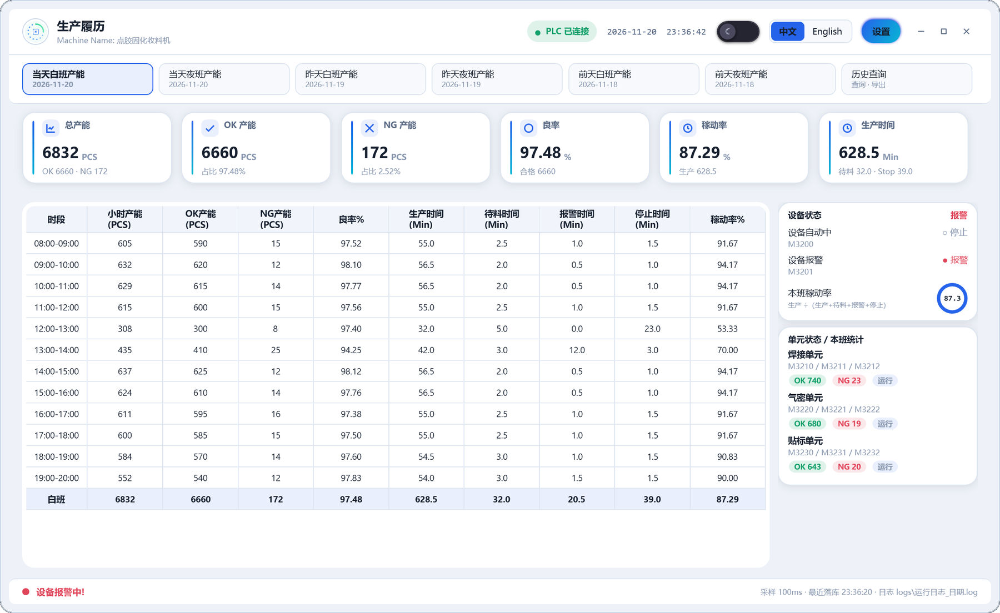
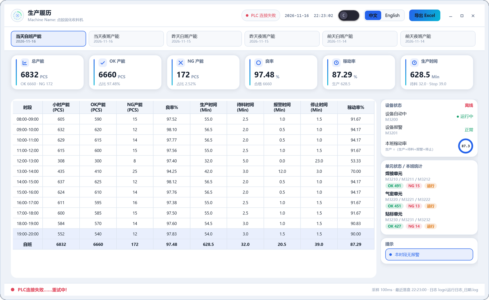
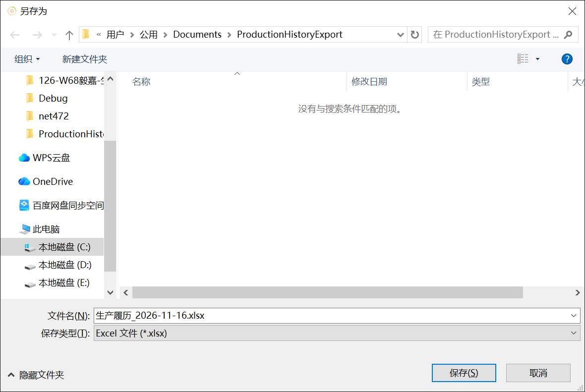

# 生产统计 · 内部版

> 适用对象：我方售后、实施、开发工程师  
> 适用设备：点胶固化收料机（三菱 FX5U）  
> 软件版本：0.0.4  
> 文档版本：2026-11-16  
> 保密级别：内部资料，不随客户交付

## 一、系统全景

### 1.1 工程结构

| 工程 | 目录 | 角色 | 说明 |
| --- | --- | --- | --- |
| WPF 版 | `ProductionStatistics\` | **本次交付对象** | .NET Framework 4.7.2 + WPF，版本 0.0.4 |
| 业务代码 | `ProductionStatistics\Business\` | 工程内源码 | 班次统计、INI 解析、日志、PLC 地址配置与信号处理 |
| 二进制依赖 | `libs\` | 仓库根目录 | 第三方 DLL 唯一存放地（`EPPlus.dll` / `HslCommunication.dll`），必须入库；csproj 与 `tools\` 工具链共用同一份 |
| 源码级依赖 | `extern\` | 仓库根目录 | git submodule（kaleidoscope 通讯/UI 库），其内部 `libs\` 由子模块自行管理 |

原 WinForms 工程已移除，其 6 个共用业务文件（`ShiftStore.cs`、`SimpleIni.cs`、`Log.cs`、`PlcAddressConfig.cs`、`PlcSignalResetter.cs`、`TriggerDebouncer.cs`）已迁入 WPF 工程的 `ProductionStatistics\Business\`，由 SDK 工程默认 glob 自动收录，不再使用链接引用。

### 1.2 运行时目录

以 `bin\Debug\net472\` 为例：

```text
net472\
├─ ProductionStatistics.Wpf.exe      主程序
├─ ProductionStatistics.Wpf.exe.config
├─ HslCommunication.dll              PLC 通讯库（不能删）
├─ EPPlus.dll                        Excel 生成库（不能删）
├─ 生产统计.ini                      现场配置（UTF-8，无 BOM）
├─ 数据\
│   ├─ 生产履历_2026-11-16.csv       UTF-8 BOM，25 行 × 14 列
│   └─ ...
├─ logs\
│   ├─ 运行日志_2026-11-16.log       UTF-8 BOM，按天
│   └─ ...
└─ 错误日志.txt                       ERROR 级镜像，持续追加
```

`数据`、`logs` 的路径都取 `AppDomain.CurrentDomain.BaseDirectory`，即 exe 所在目录。不要从网络盘、U 盘直接运行，也不要把 exe 复制到只读目录。

### 1.3 文件职责

| 文件 | 职责 | 改动风险 |
| --- | --- | --- |
| `MainWindow.xaml.cs` | 界面刷新、页签、语言、主题、导出入口、关窗落盘 | 高：UI 线程与采集线程的边界 |
| `Services\PlcCollector.cs` | PLC 轮询、计数、时间累计、日志 | 最高：统计口径全在这里 |
| `Services\StatisticsStore.cs` | 内存数据仓库、CSV 落盘 | 高：锁与文件格式 |
| `Services\ExcelExporter.cs` | xlsx 生成 | 中：导出格式 |
| `Services\AppConfig.cs` | ini 读取、默认配置、主题写回 | 中：配置缺失会导致启动异常 |
| `ShiftStore.cs` | 小时桶、班次定义、CSV 读写 | 高：两版共用 |
| `PlcAddressConfig.cs` | 11 个地址键解析、连续性判断 | 中：地址错会导致采集错 |
| `PlcSignalResetter.cs` | 自锁位复位、不复位集合 | 高：复位错会重复计数/漏计 |
| `TriggerDebouncer.cs` | 上升沿与去抖状态机 | 高：计数正确性 |
| `Log.cs` | 分级日志、节流、30 天清理、ERROR 镜像 | 低：失败静默降级 |
| `SimpleIni.cs` | 极简 ini 解析 | 低 |
| `tools\DocShot\` | 截图/演示数据/核验工具链（不随客户交付） | 低：只用于文档 |

## 二、权限矩阵实况

### 2.1 软件层

| 能力 | 操作员 | 客户工程师 | 我方工程师 | 备注 |
| --- | --- | --- | --- | --- |
| 查看全部班次 | 有 | 有 | 有 | 无角色限制 |
| 导出 Excel | 有 | 有 | 有 | 无导出次数/范围限制 |
| 切换语言/主题 | 有 | 有 | 有 | 主题写回 ini |
| 改 ini | 有（文件系统） | 有 | 有 | 软件内无配置界面 |
| 删数据/日志 | 有（文件系统） | 有 | 有 | 无软删除/回收站 |
| 看运行日志 | 有（文件系统） | 有 | 有 | 日志不按人记录 |

**结论：本项目没有账号、角色、授权码、审计日志。** 文档中不得虚构“管理员登录”“操作员权限”“授权到期”等章节；客户问起时按本节如实回答，并给出 Windows 账户/NTFS/机柜锁等替代措施。

### 2.2 进程层

- 无单实例互斥：`MainWindow` 构造时没有 Mutex/命名管道检查，双击两次会起两个进程。
- 两个进程各自持有内存副本，每 30 秒各自整文件覆盖同一个 CSV，后写者赢，数据会丢。
- 没有文件锁、没有 PID 文件、没有端口占用冲突（PLC 允许并发连接）。
- 现场规避：只留一个窗口；需要更强保护时，在 `App.xaml.cs` 启动处加 `Mutex`（见 13 章待办）。

### 2.3 文件层

| 路径 | 默认权限 | 建议 |
| --- | --- | --- |
| exe 目录 | 继承 Program Files / 自定义目录 | 运行账户可读可执行 |
| `生产统计.ini` | 继承 | 设只读，仅管理员可写 |
| `数据\` | 继承 | 运行账户可写；纳入每日备份 |
| `logs\` | 继承 | 运行账户可写；保留 30 天 |
| 导出目录 | 用户选择 | 纳入数据外发管理 |
## 三、界面刷新链路

### 3.1 线程模型

```text
采集线程（PlcCollector.采集循环）
  ├─ 每轮读 4 次 PLC 报文
  ├─ 计数 / 累计时间（lock 统计.锁）
  ├─ dataDirty = true
  └─ 事件 数据已变化 / 连接状态已变化 / 设备状态已变化

UI 线程（DispatcherTimer，1 秒）
  ├─ 读 dataDirty，消费后置 false
  ├─ 刷新表格 / KPI / 单元状态 / 提示
  └─ 刷新状态条与连接状态

落盘（采集线程内，每 30 秒）
  └─ StatisticsStore.保存全部()：锁内快照，锁外写文件
```

关键约定：**采集线程绝不碰控件**。连接状态事件用 `Dispatcher.BeginInvoke`（`MainWindow.xaml.cs:111-114`），不用 `Invoke`，避免 UI 线程持锁等采集线程造成互等。`dataDirty` 是 `volatile bool`（`PlcCollector.cs:118`），采集线程只置位，UI 线程消费。

### 3.2 刷新入口

| 刷新对象 | 方法 | 行号 | 触发条件 | 数据范围 |
| --- | --- | --- | --- | --- |
| 时钟、跨天页签 | `刷新定时器_Tick` | `MainWindow.xaml.cs:136` | 每 1 秒 | 系统时间 |
| 表格 12 行 + 合计 | `刷新表格` | `MainWindow.xaml.cs:181` | 脏标志 / 切页签 / 切语言 | 选中页签 |
| 6 张 KPI | `刷新KPI` | `MainWindow.xaml.cs:213` | 同上 | 选中页签 |
| 三单元 OK/NG/IDLE | `刷新单元状态` | `MainWindow.xaml.cs:261` | 脏标志 / 切语言 | **当前时间班次** |
| 提示卡 | `刷新提示` | `MainWindow.xaml.cs:287` | 脏标志 / 切页签 / 主题 / 语言 | 当前小时报警 |
| 底栏四态 | `刷新状态条` | `MainWindow.xaml.cs:331` | 每 1 秒 | 实时信号 |
| 顶栏连接状态 | `刷新连接状态` | `MainWindow.xaml.cs:386` | 每 1 秒 + 事件 | 实时 |

### 3.3 页签切换的行为

`页签按钮_Click`（`MainWindow.xaml.cs:403`）只做四件事：

1. 更新 `选中页签`；
2. 刷新页签选中态；
3. 调 `刷新表格()`、`刷新KPI()`、`刷新提示()`；
4. 不调 `刷新单元状态()`，也不改右栏的“本班统计”。

右栏在 `刷新单元状态` 里用 `DateTime.Now` 重新算当前班次（`MainWindow.xaml.cs:263-266`），所以它永远跟随墙上时间，不跟随页签。这是现场最容易误报“数据串了”的点，培训文档必须解释。

### 3.4 语言与主题

- `应用语言`（`MainWindow.xaml.cs:449`）一次性设置全部静态文字，再调各刷新方法；`语言切换中` 标志防止 RadioButton 互斥触发递归。
- `主题开关_Click`（`MainWindow.xaml.cs:416`）切换资源字典并调用 `AppConfig.保存主题`，立即写回 ini。
- 语言没有写回：`应用语言` 只改内存 `英文界面`，重启后按 `[界面] 语言` 重新决定。
- 导出列头取 `表格.Columns[i].Header`（`MainWindow.xaml.cs:524`），因此英文界面导出英文列头；CSV 列头固定中文。

## 四、配置逐项说明

### 4.1 读取链路

`AppConfig.载入()`（`Services/AppConfig.cs:43`）在 App 启动时执行：

1. 读 exe 目录的 `生产统计.ini`；
2. 缺失的节/键用默认值补齐；
3. 解析 `[PLC地址]` 到 `PlcAddressConfig`（`PlcAddressConfig.cs:66`）；
4. 首次运行或老 ini 没有 `[PLC地址]` 段时，补写默认段（`AppConfig.cs:69`）。

`SimpleIni.Load`（`SimpleIni.cs:24`）只支持 `key=value`、`[section]`、`#` 注释，不支持行内注释、引号转义、多行值。现场如果把值写在 `#` 后面，会被整行忽略。

### 4.2 生效时机

| 配置 | 键 | 生效时机 | 备注 |
| --- | --- | --- | --- |
| PLC IP | `[PLC] IP` | 重启 | 采集启动时使用 |
| PLC 端口 | `[PLC] Port` | 重启 | 默认 6060 |
| 轮询间隔 | `[PLC] 轮询间隔Ms` | 重启 | 代码下限 50 ms（`PlcCollector.cs:137`） |
| OFF 确认时长 | `[PLC] 信号确认OFF毫秒` | 重启 | 下限 100（`:139`），缺省 300；按 OFF 持续时长确认（V0.0.1 前为"轮数"口径已退役） |
| 最小计数间隔 | `[PLC] 计数最小间隔Ms` | 重启 | 下限 0.2 秒（`:138`），运行时还会按 2.5×采样周期抬高 |
| 设备中文名 | `[界面] 设备名称` | 重启 | 标题、导出标题 |
| 设备英文名 | `[界面] 设备名称En` | 重启 | 英文界面；不要含 `&`，Label 会吞 |
| 默认语言 | `[界面] 语言` | 重启 | 中文 / English |
| 默认主题 | `[界面] 主题` | 重启 | 深色 / 浅色；运行中切换会写回 |
| 11 个地址 | `[PLC地址]` | 重启 | 地址统一转大写（`PlcAddressConfig.cs:90`） |
| 不复位地址 | `[PLC地址] 不复位地址` | 重启 | 逗号/分号/空格分隔（`PlcSignalResetter.cs:49-51`） |

### 4.3 地址校验

`PlcAddressConfig.解析地址`（`PlcAddressConfig.cs:143`）把 `M3210` 解析成数值 3210，用于判断连续性：

- `单元地址连续(单元号)`（`:121`）：OK/NG/IDLE 三个数值连续 → 一次 `ReadBool(起始,3)`；
- `自动中报警连续()`（`:131`）：两个数值连续 → 一次 `ReadBool(起始,2)`；
- 不连续 → 分点读，报文数增加，但功能不受影响。

地址非法（空、非 M 开头、数值越界）不会在启动时拦截，而是在采集时报错并持续离线。现场改地址后必须看日志的 `PLC 地址配置:` 摘要行（`PlcCollector.cs:145`）确认解析结果。
## 五、采集与计数实现

### 5.1 启动与线程

`PlcCollector.启动`（`Services/PlcCollector.cs:135`）：

1. `readInterval = Math.Max(50, 配置值)`（`:137`）；
2. 读 `计数最小间隔Ms` 与 `信号确认OFF毫秒`，各自设下限（`:138-139`）；
3. 建 `MelsecMcNet(ip, port)`，连接/接收超时都设 2 秒（`:140-142`）；
4. 首次 `ConnectServer()` 失败只记 WARN，不退出（`:147-154`）；
5. 启动后台线程 `采集线程`（`:156-160`）。

`停止`（`:164`）置 `停止标志` 并关连接；线程在下一轮 `while` 顶部退出（`:215-217`）。关窗时 `OnClosing`（`MainWindow.xaml.cs:723`）先停定时器、再停采集、最后 `保存全部()`。

### 5.2 一轮循环做什么

| 顺序 | 动作 | 行号 | 失败/边界 |
| --- | --- | --- | --- |
| 1 | 检查是否到 30 秒，落盘 | `:221-226` | 离线也落盘 |
| 2 | 读三单元各 3 点 + 自动/报警 2 点 | `:230-236` | 任一失败 → 离线，`continue` |
| 3 | 展开 6 个触发位 + 9 个复位位 | `:253-269` | — |
| 4 | 算当前班次、小时下标、归属日期 | `:271-278` | 夜班跨天 |
| 5 | 用 Stopwatch 算真实间隔 | `:282-298` | >10 秒整段丢弃 |
| 6 | 锁内计数 + 时间归类 | `:305-397` | 锁内无 IO |
| 7 | 锁外复位自锁位 | `:400-405` | 失败记 WARN |
| 8 | 设备状态变化日志 | `:408-421` | 5 秒节流 |
| 9 | 跨整点小时结算 | `:423-431` | 失败记 ERROR |
| 10 | 每分钟时间账目/产量小结 | `:433-492` | 计数清零 |
| 11 | Sleep 轮询间隔 | `:499-501` | 内层 catch 兜底 |

### 5.3 首次采样

首次成功采样只作基准，不计产量（`PlcCollector.cs:311-325`）：

- 把当前 6 个触发位同步进去抖器与 `lastTriggerStates`；
- 若某位已经是 ON，记录 `连续On次数=1` 与 ON 起始时刻；
- 写日志「首次采样完成（作为计数基准，本次不计产量）」；
- 随后仍然执行复位，把残留 ON 清掉。

这一条是 V2.1.0 修“生产了却没计数”的关键：如果启动时 PLC 触发位残留 ON，老逻辑会把它当成一件新产品，之后一直 ON 再也计不到数。

### 5.4 上升沿与去抖

`TriggerDebouncer` 是两版共用状态机（`ProductionStatistics\Business\TriggerDebouncer.cs`）：

- 维护每个触发位的上一轮状态、连续 OFF 轮数、上次计数时刻；
- 只有“上一轮 OFF + 本轮 ON + 距上次计数 ≥ 最小间隔 + 已确认 OFF 轮数”才返回 `true`；
- 最小间隔在运行时被抬高到 `max(配置值, 2.5 × 实测采样周期)`（`PlcCollector.cs:300-302`）；
- 复位后 PLC 快速重置位产生的短暂 OFF 不算“上一件结束”，必须连续 OFF 达到 `确认OFF轮数`。

计数动作（`PlcCollector.cs:343-344`）：

```csharp
if (i % 2 == 0) { hs.AddOk(i / 2); 本分钟单元OK[i / 2]++; }
else            { hs.AddNg(i / 2); 本分钟单元NG[i / 2]++; }
```

下标映射：0/1=焊接 OK/NG，2/3=气密 OK/NG，4/5=贴标 OK/NG。

### 5.5 窄脉冲诊断

下降沿时计算脉冲宽度（`PlcCollector.cs:349-386`）：

- 整个脉冲只被采到 1 次，或宽度 < 1.5 × 采样周期 → 计为“可疑脉冲”；
- 自锁位：提示“复位后重新置位间隔约 X ms，接近单轮采样周期”，5 分钟节流；
- 非自锁位：提示“脉冲可能太窄而被整段漏掉”，60 秒节流；
- 建议都是“改 PLC 为置位保持型”或“调小轮询间隔”。

注意：自锁位的“宽度”天然接近采样周期（软件一读到就复位），所以这条告警对自锁位更多是提醒节拍过快，不代表一定会漏计。
### 5.6 时间记账

四类时间在同一把锁内按固定优先级累加（`PlcCollector.cs:390-396`）：

```csharp
if (latestAlarm)            hs.AlarmSec      += 间隔秒;
else if (latestAuto)        hs.ProductionSec += 间隔秒;
else if (任一 IDLE)         hs.WaitSec      += 间隔秒;
else                        hs.StopSec      += 间隔秒;
```

- `间隔秒` 是两次**成功采样**之间的 Stopwatch 实测值（`:282-296`），不是 `readInterval/1000`。
- 单次间隔 > 10 秒（`:211`）整段丢弃并写 WARN（`:287-294`），防止电脑休眠后把一小时假时间灌进当前桶。
- 读取失败时 `上次采样秒 = -1`（`:247`），恢复后重新起算，离线时段不落入任何一类。
- 因为四类互斥且覆盖，正常运行时 `生产+待料+报警+停止 ≈ 墙上时间`，这是现场验收的核心等式。

### 5.7 落盘、小时结算、每分钟日志

| 动作 | 触发 | 行号 | 说明 |
| --- | --- | --- | --- |
| CSV 落盘 | 每 30 秒 | `:221-226` | 在循环开头，离线也存 |
| 小时结算 | 小时键变化 | `:423-431` | 调 `记录小时结算`（`:553`） |
| 时间账目 | 每 60 秒 | `:444-455` | 墙上秒 vs 计入秒、差额、离线次数、采样/报文耗时 |
| 本分钟产量 | 每 60 秒 | `:458-465` | 三单元 OK/NG、可疑脉冲、5 个信号状态 |
| 生产却无计数 | 每分钟且生产 ≥30 秒、产量为 0 | `:468-471` | WARN，提示查地址/脉冲/自锁 |
| 计数速率异常 | 每触发位每分钟 ≥60 次 | `:474-481` | **当前不会触发，见 5.8** |

小时键格式：`yyyy-MM-dd` + `白班/夜班` + 两位小时下标，例如 `2026-11-16夜班03`。`记录小时结算` 解析这个字符串，从内存取同一份 `HourStat` 打印，保证界面、CSV、日志三处口径一致。

### 5.8 已知缺陷（当前版本真实存在）

| 缺陷 | 位置 | 影响 | 处理建议 |
| --- | --- | --- | --- |
| 计数速率异常告警是哑告警 | `PlcCollector.cs:201` 声明 `本分钟上升沿`，`:476` 判断 `>=60`，全文件没有 `++` | 该 WARN 永远不会触发，地址配到常 ON 点 / 信号抖动时少一道日志线索 | 在 `:343-344` 计数的同时 `本分钟上升沿[i]++`，或删掉这段死代码 |
| 去抖最小间隔重复赋值 | `PlcCollector.cs:300-302` | 同一表达式连写两遍，无功能影响 | 删掉其中一行，减少维护困惑 |
| 无单实例保护 | `App.xaml.cs` / `MainWindow` 构造 | 双开互相覆盖 CSV | 启动加 `Mutex`，第二个实例提示后退出 |
| 语言不写回 | `MainWindow.xaml.cs:449` | 重启回 ini 设定 | 产品设计如此，文档已解释 |
| 右栏不随页签 | `MainWindow.xaml.cs:261-266` | 历史页签下右栏仍是当前班次 | 产品设计如此，培训重点解释 |

### 5.9 日志节流

- 设备状态变化用 `Log.Info节流("设备状态变化", ..., 5)`（`PlcCollector.cs:412`），同一状态 5 秒内只记一条。
- 窄脉冲按地址分别节流：自锁位 300 秒、非自锁位 60 秒（`:366-381`）。
- PLC 未连上时每 60 秒记一条“仍在重试”（`:585`）。
- 落盘成功日志每 10 分钟一条（`StatisticsStore.cs:94`），避免每 30 秒刷屏。
- 日志节流表在内存里，进程重启后清空；重启瞬间可能重复几条，属正常。
## 六、存储与载入

### 6.1 内存结构

| 类型 | 文件:行 | 内容 |
| --- | --- | --- |
| `HourStat` | `ShiftStore.cs:16` | 三单元 OK/NG 数组、四类时间秒数、只读合计属性 |
| `DayRecord` | `ShiftStore.cs:47` | `DayShift[12]` + `NightShift[12]` |
| `StatisticsStore` | `Services/StatisticsStore.cs:20` | `Dictionary<DateTime, DayRecord>` + 锁 + 落盘节流时间 |

`HourStat.TotalCount = OkCount + NgCount`（`ShiftStore.cs:34`），`OkCount/NgCount` 由三个单元求和（`:28-31`），不单独存一份，避免三处不一致。

### 6.2 CSV 格式

| 项目 | 值 | 代码位置 |
| --- | --- | --- |
| 目录 | exe 下 `数据\` | `ShiftStore.cs:90` |
| 文件名 | `生产履历_yyyy-MM-dd.csv` | `ShiftStore.cs:96` |
| 编码 | UTF-8 带 BOM | `StatisticsStore.cs:91`、`ShiftStore.cs:133` |
| 行数 | 25（表头 + 白班 12 + 夜班 12） | `ShiftStore.cs:79` |
| 列数 | 14 | `ShiftStore.cs:82-87` |
| 行序 | 第 2–13 行白班，第 14–25 行夜班 | `ShiftStore.cs:164-170` |
| 数字格式 | InvariantCulture，固定 `.` | `ShiftStore.cs:147-150` |
| 写方式 | 整文件覆盖，非追加 | `StatisticsStore.cs:90-91` |

`Load`（`ShiftStore.cs:157`）严格按行序解析，不按“时段”文字匹配；任何一行 `cols.Length < 14` 或数字解析失败只跳过该行（`:167`、`:183-186`），其余数据保留。这是“现场手改 CSV 后还能启动”的兜底。

### 6.3 载入与保留

- 启动 `StatisticsStore.载入最近三天()`（`StatisticsStore.cs:35`）：只读今天、昨天、前天；文件不存在就建空白记录，不报错。
- 内存保留 7 天：`保存全部` 时删除 `< Today-7` 的键（`:79-83`）。
- 因此“7 天保留”只在连续运行跨 7 天时有意义；重启后只载入 3 天，第 4–7 天的内存数据不会恢复（磁盘 CSV 仍在，但界面不显示）。
- 落盘每 30 秒一次，断电最多丢 30 秒；关窗 `OnClosing` 会强制再存一次。

### 6.4 锁与 IO 纪律

`保存全部()`（`StatisticsStore.cs:71`）在锁内只做两件事：清理过期键、把每天序列化成字符串快照；出锁后才 `Directory.CreateDirectory` 与 `File.WriteAllText`（`:88-91`）。采集线程的计数与 UI 的读都在同一把 `统计.锁` 内，锁内禁止网络/文件 IO。

异常处理：写文件失败返回 `"数据保存失败:..."`，由界面标题栏/日志提示（`:101-104`），不会让采集线程退出。

## 七、导出实现

### 7.1 入口

`MainWindow.导出按钮_Click`（`MainWindow.xaml.cs:510`）：

1. 由 `选中页签 / 2` 算日期；
2. `SaveFileDialog` 默认文件名 `生产履历_日期.xlsx`；
3. 锁内取 `DayRecord`；
4. 用当前界面表头拼 10 个列头（`:523-524`）；
5. 调 `ExcelExporter.导出`；
6. 成功/失败弹 MessageBox，失败写 `Log.Error`。

### 7.2 快照结构

`ExcelExporter.生成快照`（`Services/ExcelExporter.cs:46`）建 `object[27,10]`：

| 快照行 | 内容 | Excel 行 |
| --- | --- | --- |
| 0 | 表头 | 3 |
| 1–12 | 白班 12 小时 | 4–15 |
| 13 | 白班合计 | 16 |
| 14–25 | 夜班 12 小时 | 17–28 |
| 26 | 夜班合计 | 29 |

第 1 行是合并单元格的标题（设备名 + 生产履历 + 日期），第 2 行空行（`ExcelExporter.cs:26-31`）。表头行、两行合计行加粗（`:34-39`），最后 `AutoFitColumns`。

### 7.3 列与算法

| 列 | 内容 | 算法/来源 |
| --- | --- | --- |
| A | 时段 | `ShiftTitles` 生成，固定中文 |
| B | 小时产能 | `TotalCount` |
| C | OK | 三单元 OK 和 |
| D | NG | 三单元 NG 和 |
| E | 良率% | `OK/(OK+NG)*100`，2 位 |
| F–I | 生产/待料/报警/停止 | 秒 ÷ 60，1 位 |
| J | 稼动率% | 生产秒 ÷ 四类秒和 × 100，2 位 |

合计行先累加秒再算比率（`ExcelExporter.cs:86-91`），不是对 12 行百分比求平均。

### 7.4 依赖与边界

- 使用 EPPlus（`OfficeOpenXml`）生成，电脑不需要安装 Office；查看时需要 Excel/WPS。
- 导出失败常见原因：文件被 Excel 占用、目录无写权限、磁盘满。
- 数据量固定 27×10，导出耗时通常在百毫秒级；导出在 UI 线程同步执行，极端慢盘上可能有短暂卡顿。
## 八、日志与诊断

### 8.1 日志实现

| 项目 | 值 | 代码位置 |
| --- | --- | --- |
| 目录 | exe 下 `logs\` | `Log.cs:44-47` |
| 文件 | `运行日志_yyyy-MM-dd.log` | `Log.cs:56-59` |
| 编码 | UTF-8 带 BOM | `Log.cs:139` 起 |
| 格式 | `yyyy-MM-dd HH:mm:ss.fff 级别 [线程] 内容` | `Log.cs:145` |
| 级别 | INFO / WARN / ERROR | `Log.cs:80-100` |
| 保留 | 30 天，启动时清理 | `Log.cs:41`、`:183-194` |
| ERROR 镜像 | exe 下 `错误日志.txt`，追加 | `Log.cs:50-53`、`:139` 起 |
| 节流 | 同键最小间隔内只写第一条 | `Log.cs:108-137` |
| 写失败 | 全部 try-catch，静默降级 | `Log.cs:28-30` |

`Log.Init()`（`:65`）在程序启动时建目录、清过期、写分隔线。日志写入用 `写锁` 串行化（`:35`），采集线程、UI 线程、异常处理都可能写，不会互相穿插。

### 8.2 关键日志速查

| 关键字 | 含义 | 现场处理 |
| --- | --- | --- |
| `----- 日志开始` | 进程启动分隔线 | 用来定位重启时刻 |
| `读取配置: IP=...` | 启动时的连接参数 | 核对 IP/端口/轮询 |
| `PLC 地址配置: ...` | 解析后的 11 个地址摘要 | 核对是否与 ini 一致 |
| `PLC 连接成功` | 首次连接成功 | 正常 |
| `PLC 连接失败（程序会自动重试）` | 首次连接失败 | 查物理层/IP；会持续重试 |
| `PLC 已恢复连接` | 断线后恢复 | 记下恢复时间 |
| `PLC 连接断开: ...` | 运行中断线 | 记下断开时间与原因 |
| `PLC 仍未连上（继续重试中）` | 离线期间每 60 秒一条 | 证明进程还活着 |
| `首次采样完成（作为计数基准...）` | 启动后第一次成功采样 | 这一轮不计产量，正常 |
| `设备状态: X → Y` | 运行/待料/报警/停止切换 | 复盘状态时间线 |
| `时间账目 采样=... 墙上经过=... 计入=... 差额=...` | 每分钟时间对账 | 差额应接近 0；大差额查休眠/卡顿 |
| `本分钟产量 焊接OK=...` | 每分钟三单元增量 | 判断哪个单元没计数 |
| `小时结算 ...` | 跨整点打印上一小时 | 核对小时产量与四类分钟 |
| `落盘成功: N 天数据` | 每 10 分钟一条 | 证明写盘正常 |
| `采样间隔异常 X 秒` | 单次间隔 >10 秒被丢弃 | 查电脑休眠/卡顿；这段不计时 |
| `自锁位 ... 接近单轮采样周期` | 节拍接近采样极限 | 调小轮询或改 PLC 脉冲 |
| `触发位 ... 脉冲宽度约 ...ms` | 非自锁位窄脉冲 | 改置位保持型或调小轮询 |
| `PLC 信号复位失败` | 写回 false 失败 | 可能重复计数/漏计，查通讯 |
| `保存 CSV 失败` | 写文件异常 | 查磁盘/权限/路径 |
| `导出 Excel 失败` | 导出异常 | 查文件占用/权限 |
| `采集线程异常退出` | 外层兜底捕获 | 必须重启软件并保留日志 |

### 8.3 诊断顺序

1. **先看启动段**：配置、地址、首次连接是否成功。
2. **再看断线记录**：`PLC 连接断开` 与 `PLC 已恢复连接` 的时间点。
3. **看时间账目**：差额是否持续偏大、离线次数是否增加。
4. **看本分钟产量**：三个单元是否都有增量，哪个单元长期为 0。
5. **看窄脉冲/复位失败**：计数异常的根因通常在这两类。
6. **看小时结算**：与界面、CSV 三方核对。
7. **看 ERROR 镜像**：`错误日志.txt` 里通常是保存失败、导出失败、线程异常。

## 九、故障树

### 9.1 产量完全不增

```text
产量不增
├─ PLC 是否在线？──否──> 查网络/IP/端口（日志有断开原因）
├─ 触发位是否变化？──否──> PLC 程序/接线/地址错
├─ 软件是否读到 ON？──否──> 地址配错、点位越界
├─ 是否首次采样残留 ON？──是──> 复位失败/复位被排除
├─ 脉冲是否 < 采样周期？──是──> 调小轮询或改置位保持
└─ 是否被最小间隔压掉？──是──> 调小 计数最小间隔Ms（须小于节拍）
```

验证：日志「首次采样完成」里的 6 位状态、每分钟「本分钟产量」、PLC 侧监视。

### 9.2 同一件产品重复计数

```text
重复计数
├─ 触发位地址是否指到常 ON 点？──是──> 改地址
├─ 信号是否抖动（ON/OFF 快速翻转）？──是──> PLC 侧滤波/改自锁
├─ 复位后 PLC 是否立刻重置位？──是──> 加 信号确认OFF毫秒 / 加大最小间隔
├─ 复位是否失败？──是──> 查日志「PLC 信号复位失败」
└─ 是否双开两个软件？──是──> 只留一个（两进程各计一遍）
```

### 9.3 四类时间之和明显小于墙上时间

| 根因 | 验证 | 处理 |
| --- | --- | --- |
| PLC 离线 | 日志断线记录、离线次数 | 修网络；离线时段本就不计 |
| 电脑休眠/挂起 | 日志「采样间隔异常」 | 关闭休眠；电源计划设高性能 |
| 软件被长时间卡住 | 「时间账目」差额大、单轮 max 大 | 查杀毒/磁盘/CPU 占用 |
| 采样间隔 >10 秒被丢弃 | 同上 | 同上，属保护逻辑 |
| 当班尚未结束 | 当前时间 < 下班时间 | 正常，四类之和小于 12 小时 |

### 9.4 离线

按客户版 12.2 的顺序排查；内部额外看：

- `PLC 连接失败` 的 `Message` 是超时、拒绝连接还是协议错误；
- 是否只有某一台设备/某一个网段出问题；
- 交换机是否开了端口隔离/风暴抑制；
- 工控机是否装了会改路由的 VPN/虚拟网卡；
- PLC 连接数是否被其他上位机占满。
### 9.5 CSV 不更新或丢数

| 根因 | 验证 | 处理 |
| --- | --- | --- |
| 数据目录不可写 | 日志「保存 CSV 失败」 | 查权限/磁盘/只读属性 |
| 磁盘满 | 资源管理器剩余空间 | 清理；日志有异常消息 |
| 双开互相覆盖 | 任务管理器有两个进程 | 只留一个；补单实例保护 |
| 手工改 CSV 后被覆盖 | 文件修改时间每 30 秒变 | 正常设计；要改先停软件并另存 |
| 断电早于 30 秒 | 最后一条「落盘成功」时间 | 最多丢 30 秒，属设计边界 |
| 目录被删/改名 | 日志写文件失败 | 恢复目录；重启软件自愈 |
| 杀毒软件隔离 exe/数据 | 杀毒日志 | 加白名单 |

### 9.6 导出失败

| 根因 | 验证 | 处理 |
| --- | --- | --- |
| xlsx 正被 Excel/WPS 打开 | 看文件名与占用 | 关闭文件后重导 |
| 目录无写权限 | 换桌面试 | 换目录/修权限 |
| 磁盘满 | 剩余空间 | 清理 |
| EPPlus.dll 缺失 | exe 目录文件列表 | 从交付包补回 |
| 文件被杀毒锁定 | 杀毒日志 | 加白名单 |
| 导出后立即打开失败 | 文件大小 0/异常 | 重导；仍失败保留日志 |

### 9.7 双开覆盖

两个进程都加载“今天/昨天/前天”的 CSV 到内存，之后各自每 30 秒整文件覆盖。表现为数字来回跳、刚记的数消失、某个单元的计数突然归零。验证：任务管理器看 `ProductionStatistics.Wpf.exe` 实例数；日志里同一天有两段“日志开始”。处理：关掉一个，保留最后启动的那个；必要时从备份恢复 CSV。

### 9.8 数据损坏与恢复

1. 立即停软件，复制整个 `数据` 与 `logs` 留证。
2. 用 Excel 打开 CSV，检查行数是否为 25、列数是否为 14、数字列是否可解析。
3. 备份坏文件后，用最近一份好备份覆盖。
4. 启动软件，核对页签总数与四类时间。
5. 若只有单行坏，`Load` 会跳过该行，其余可用；不要手工补行，除非能保证 14 列格式。

### 9.9 卡顿/CPU 高

| 根因 | 验证 | 处理 |
| --- | --- | --- |
| 轮询间隔过小 | 日志单轮周期、PLC 负载 | 调回 100–200 ms |
| 地址不连续，报文多 | 日志「PLC 地址配置」与读取耗时 | 改为连续地址 |
| 日志文件过大 | logs 目录体积 | 保留 30 天自动清理；手工归档 |
| 磁盘 IO 慢 | 落盘耗时、杀毒扫描 | 换 SSD/加白名单 |
| 界面动画/远程桌面 | 现场观察 | 本机运行，避免远程桌面长时间挂起 |

## 十、交付与维护

### 10.1 编译

WPF 主工程（二选一）：

```powershell
dotnet build .\ProductionStatistics\ProductionStatistics.csproj -c Debug
# 或
msbuild .\ProductionStatistics\ProductionStatistics.csproj /p:Configuration=Debug
```

要求 .NET Framework 4.7.2 Developer Pack / .NET SDK；工程是 SDK-style + `UseWPF`，不要改回传统 csproj。输出在 `ProductionStatistics\bin\Debug\net472\`。

截图工具链（不属于交付物，只用于文档复现）：

```powershell
csc /nologo /codepage:65001 /target:winexe /out:tools\DocShot\build\DocShot.exe ^
  /r:libs\HslCommunication.dll ^
  /r:"%WINDIR%\Microsoft.NET\Framework64\v4.0.30319\WPF\UIAutomationClient.dll" ^
  /r:"%WINDIR%\Microsoft.NET\Framework64\v4.0.30319\WPF\UIAutomationTypes.dll" ^
  /r:"%WINDIR%\Microsoft.NET\Framework64\v4.0.30319\WPF\WindowsBase.dll" ^
  tools\DocShot\DocShot.cs

csc /nologo /codepage:65001 /target:exe /out:tools\DocShot\build\FakePlc.exe ^
  /r:libs\HslCommunication.dll tools\DocShot\FakePlc.cs

# FakePlc.exe 运行时要求 HslCommunication.dll 在自身目录（/r 只编译期引用，不复制文件）
copy /Y libs\HslCommunication.dll tools\DocShot\build\ >nul
```

### 10.2 部署清单

| 文件/目录 | 必须 | 说明 |
| --- | --- | --- |
| `ProductionStatistics.Wpf.exe` | 是 | 主程序 |
| `ProductionStatistics.Wpf.exe.config` | 是 | 绑定重定向等 |
| `HslCommunication.dll` | 是 | PLC 通讯 |
| `EPPlus.dll` | 是 | Excel 导出 |
| `生产统计.ini` | 是 | 现场配置；没有会自动生成默认 |
| `数据\` | 自动 | 首次运行创建 |
| `logs\` | 自动 | 首次运行创建 |
| `app.ico` / `app.png` | 否 | 界面/快捷方式图标 |

部署步骤：停旧进程 → 备份 ini/数据/logs → 覆盖程序文件（保留 ini 与数据）→ 启动 → 看连接、地址摘要、时间账目 → 连续跑 20 件核对。

### 10.3 升级与回滚

- 升级前必须备份 `生产统计.ini` 与整个 `数据`。
- 新旧版本共用同一 CSV 格式（14 列 × 25 行）；如果新版本改了列，必须先做数据迁移脚本。
- 回滚：停进程 → 换回旧 exe/dll → 恢复 ini 与数据 → 启动核对。
- 版本号在 csproj 的 `<Version>`/`<FileVersion>`/`<AssemblyVersion>`，当前 0.0.4；发布前同步这三处，否则 exe 属性与文档不一致。

### 10.4 文档截图复现

`tools\DocShot\` 是固定工具目录，流程：

1. `python seed_data.py` 生成三天演示 CSV（UTF-8 BOM，14 列 × 25 行）；
2. `DocShot.exe --exe ... --out ...\docs\images --fake ...\FakePlc.exe --seed ...\seed_data.py`；
3. 工具自动备份现场数据/ini/logs → 改 ini 指向 127.0.0.1 → 启假 PLC（`MelsecMcServer(true)`，端口 6060）→ 启真实 exe → 逐场景截图；
4. 拍完 `Restore()` 还原现场数据、日志、ini；
5. `python postprocess.py` 清四角黑边、裁掉对话框黑边，宽度超过 1800 的图等比缩到 1800（小图不放大）；
6. `python check_config.py` + `python check_docs.py` 做交付核验；
7. `python md_to_pdf.py` 生成 PDF，成功后删除 HTML 中间件。

已知坑：150% DPI 必须 `SetProcessDPIAware()`；UIA `Invoke` 会同步卡住主线程，导出/保存改用后台线程；页签点击要校验选中态并重试；离线截图必须先于报警截图；保存对话框用 Alt+D 导航到公共目录，避免拍进用户真实文档名。

### 10.5 现场实施记录模板

每次交付/改造复制一份，随验收单归档：

**项目信息**

| 字段 | 填写 |
| --- | --- |
| 客户 / 产线 / 工位 | |
| 设备名称（中/英） | |
| 软件版本 | 0.0.4 |
| 工控机型号 / 系统 / 屏幕分辨率 | |
| PLC 型号 / IP / 端口 | FX5U / 192.168.1.156 / 6060 |
| 11 个地址是否与现场一致 | 是 / 否（附差异） |
| 轮询 / OFF 轮数 / 最小间隔 | 100 ms / 2 / 1500 ms |
| 数据目录 / 备份路径 | |
| 实施人 / 日期 | |

**验收记录**

| 项目 | 方法 | 结果 | 备注 |
| --- | --- | --- | --- |
| 连接 | 顶栏持续绿色 10 分钟 | | |
| 计数 | 连续 100 件三方对比 | | |
| 待料 | 断料/来料各一次 | | |
| 报警 | 报警/解除各一次 | | |
| 离线 | 拔网线 1 分钟 | | |
| 重启续算 | 关软件再开 | | |
| 导出 | 检查 29 行 × 10 列与本日两班 | | |
| 权限 | 确认 ini 只读、无多余窗口 | | |

**变更记录**

| 日期 | 版本 | 改动 | 影响文件 | 回滚点 |
| --- | --- | --- | --- | --- |
| | | | | |

模板的目的不是走形式，而是把“现场到底改了什么、验收测了什么”留下证据。后续出现计数争议时，先翻这张表，能排除一半“参数被改过”的问题。
## 十一、技术实现篇

### 11.1 调用链

```text
App.xaml.cs
└─ AppConfig.载入()
   ├─ SimpleIni.Load(生产统计.ini)
   ├─ PlcAddressConfig.从Ini()
   └─ Log.Init()

MainWindow 构造（MainWindow.xaml.cs:77）
├─ 建 6 KPI / 3 单元 / 13 行表格 / 6 页签
├─ StatisticsStore.载入最近三天()（StatisticsStore.cs:35）
├─ 应用语言() + 刷新页签文字()
├─ new PlcCollector(统计, 地址) + 采集.启动()
│   └─ 采集线程：读 PLC → 计数/计时 → dataDirty
├─ 按屏幕适配窗口()
└─ DispatcherTimer 1 秒 → 刷新定时器_Tick（:136）

导出按钮（:510）→ ExcelExporter.导出()（ExcelExporter.cs:20）
关窗（:723）→ 停定时器 → 停采集 → StatisticsStore.保存全部()（StatisticsStore.cs:71）
```

### 11.2 线程与锁矩阵

| 资源 | 写者 | 读者 | 保护方式 |
| --- | --- | --- | --- |
| `dayRecords` | 采集线程 | UI、落盘 | `StatisticsStore.锁` |
| `lastTriggerStates` / 去抖器 | 采集线程 | 采集线程 | 线程内私有 |
| `latestAuto/latestAlarm/latestUnitIdle` | 采集线程 | UI | bool 原子读写，不加锁 |
| `dataDirty` | 采集线程 | UI | `volatile bool` |
| `IsPlcOnline` | 采集线程 | UI | bool 原子读写 |
| `lastSaveTime` | 采集线程 | UI 底栏 | DateTime 非原子，但只用于显示，误差可接受 |
| 控件 | UI | UI | 采集线程不碰控件 |
| 日志文件 | 任意线程 | — | `Log.写锁` |

锁顺序：**先 `统计.锁`，出锁后再做网络/文件 IO**。采集线程在锁内只改内存；`保存全部` 在锁内只生成字符串快照；UI 在锁内只读字段。没有嵌套锁，不存在死锁环。

### 11.3 关键代码地图

| 功能 | 文件:行号 |
| --- | --- |
| 主窗构造与集合初始化 | `MainWindow.xaml.cs:77` |
| 1 秒刷新定时器 | `MainWindow.xaml.cs:136` |
| 表格刷新 | `MainWindow.xaml.cs:181` |
| KPI 与稼动率圆环 | `MainWindow.xaml.cs:213` |
| 右栏单元状态（当前班次） | `MainWindow.xaml.cs:261` |
| 提示卡（当前小时报警） | `MainWindow.xaml.cs:287` |
| 底栏四态 | `MainWindow.xaml.cs:331` |
| 页签切换 | `MainWindow.xaml.cs:403` |
| 主题写回 | `MainWindow.xaml.cs:416` |
| 语言切换 | `MainWindow.xaml.cs:428` |
| 导出入口 | `MainWindow.xaml.cs:510` |
| 关窗落盘 | `MainWindow.xaml.cs:723` |
| 采集线程主循环 | `PlcCollector.cs:178` |
| 30 秒落盘触发 | `PlcCollector.cs:221` |
| 首次采样基准 | `PlcCollector.cs:311` |
| 上升沿计数 | `PlcCollector.cs:328` |
| 时间归类 | `PlcCollector.cs:393` |
| 自锁位复位 | `PlcCollector.cs:400` |
| 小时结算 | `PlcCollector.cs:553` |
| CSV 载入三天 | `StatisticsStore.cs:35` |
| CSV 落盘 | `StatisticsStore.cs:71` |
| CSV 文本生成 | `StatisticsStore.cs:109` |
| CSV 行/列定义 | `ShiftStore.cs:79`、`:82` |
| CSV 解析 | `ShiftStore.cs:157` |
| Excel 快照 | `ExcelExporter.cs:46` |
| 地址连续性 | `PlcAddressConfig.cs:121`、`:131` |
| 不复位集合 | `PlcSignalResetter.cs:39` |
| 日志保留 30 天 | `Log.cs:41` |
| 日志清理 | `Log.cs:183` |

### 11.4 版本修复史

| 版本 | 修复 | 代码证据 |
| --- | --- | --- |
| V2.1.0 | 时间记账改为 Stopwatch 真实间隔，修复“整小时停机只记 39.4 分钟” | `PlcCollector.cs:20-26`、`:282-296` |
| V2.1.0 | 首次采样只作基准，修复“启动后一直不计数” | `PlcCollector.cs:311-325` |
| V2.2.0 | 引入 `TriggerDebouncer`，修复“自锁位复位后重复计数” | `PlcCollector.cs:197-203`、`:328-345` |
| V2.2.0 | 最小间隔自动抬高到 2.5×采样周期 | `PlcCollector.cs:299-302` |
| V2.2.1 | WPF 版交付，界面重写、逻辑与 WinForms 一致 | `MainWindow.xaml.cs` 全文件 |
| V2.2.1 | 地址配置化、不复位地址、双语/主题 | `PlcAddressConfig.cs`、`AppConfig.cs` |

### 11.5 可优化项（按优先级）

1. **补单实例保护**（高）：启动 Mutex，第二个实例提示并退出，直接消除双开覆盖。
2. **修复哑告警**（中）：`本分钟上升沿[i]++`，让“计数速率异常”真正生效。
3. **删除重复赋值**（低）：`PlcCollector.cs:300-302` 去掉一行。
4. **导出异步化**（低）：数据量小，当前同步可接受；将来加图表/多日导出再改。
5. **日志归档压缩**（低）：30 天清理已够用，长期现场可加 zip。
6. **配置校验前置**（中）：启动时校验地址格式与范围，非法直接弹窗，而不是持续离线。
7. **CSV 增量写**（低）：当前整文件覆盖 25 行开销极小，不建议改。

### 11.6 一次完整计数的时序

以焊接 OK 为例，假设轮询 100 ms、实际单轮 330 ms、最小间隔 1500 ms：

| 时刻 | PLC/软件动作 | 结果 |
| --- | --- | --- |
| T+0 ms | PLC 把 M3210 置 ON，自锁保持 | 等待软件采样 |
| T+330 ms | 采集线程读到 M3210=ON；去抖器判断上轮 OFF、OFF 确认轮数已够、距上次计数 >1500 ms | `hs.AddOk(0)`，本分钟焊接 OK +1 |
| T+330 ms | 锁内写完，`dataDirty=true`；锁外 `Write(M3210,false)` | PLC 位被复位 |
| T+660 ms | 读到 OFF，连续 OFF=1 | 尚未确认结束 |
| T+990 ms | 读到 OFF，连续 OFF=2 | 确认上一件结束，等待下一个上升沿 |
| T+1 s 内 | UI 定时器消费脏标志 | 表格、KPI、右栏更新 |
| T+5 s | PLC 置位下一件 | 新上升沿，再计 1 |
| T+30 s | `保存全部()` 锁内生成 25 行文本，锁外覆盖 CSV | 落盘完成 |
| 跨整点 | 小时键变化，`记录小时结算` | 日志打印上一小时 OK/NG/四类分钟 |

异常分支：

- **复位失败**：日志 `PLC 信号复位失败: M3210(...)`，下一轮仍读到 ON，不会产生新上升沿 → 漏计；必须查通讯或 PLC 写保护。
- **PLC 重置位太快**：复位后 200 ms 又置 ON，软件可能只看到一次 OFF。若 OFF 轮数=2，这次 ON 会被当作同一件；等 PLC 下一次置位才计下一件 → 漏计。处理：加宽 PLC 脉冲或降低节拍。
- **脉冲太窄**：ON 只落在两次采样之间，软件完全没看到 → 漏计，日志会出现 `脉冲宽度`/`可疑窄脉冲`。
- **离线**：这一轮不计数、不计时，`上次采样秒=-1`；恢复后从新采样起算，不补计离线期间的产量。

### 11.7 CSV 与界面的抽样核对法

现场争议“软件少计”时，按下面顺序做一次抽样，能快速定位是 PLC、软件还是人眼：

1. 选一个整点小时，记录开始/结束的实际产量（人工计数器）。
2. 导出该日 Excel，找到对应小时行，记 B/C/D 列。
3. 打开 `数据\生产履历_日期.csv`，找到同一行（白班第 N 行 / 夜班第 N+12 行），记第 2/3/4 列。
4. 对比四处：实际、界面、Excel、CSV。正常应完全一致。
5. 若界面=Excel=CSV，但比实际少：查 PLC 脉冲/地址/去抖（第 9 章）。
6. 若 CSV 与界面不一致：查落盘时间点、是否双开、是否手改 CSV。
7. 若 Excel 与界面不一致：查导出时的页签日期、界面语言、是否导错天。

### 11.8 内部口径问答

**客户问：右栏和页签为什么对不上？**  
答：右栏按电脑当前时间算班次和小时，页签是历史回看，两者数据范围不同，属设计行为。看历史只看左表和 KPI。

**客户问：能不能加账号、限制导出？**  
答：当前版本没有账号体系，加登录/角色/审计属于二次开发，需要评估权限模型和验收标准。

**客户问：能不能对接 MES、推数据库？**  
答：当前只有 CSV 和 Excel，没有 MES 接口、没有数据库。对接需要另立项目，先确认 MES 侧的协议、字段、频率、失败重试。

**客户问：班次时间能不能改成 07:30–19:30？**  
答：不能通过 ini 改，班次起点硬编码在 `ShiftStore.ShiftTitles` 与采集线程的小时计算里，需要改代码并回归 CSV 行序。

**客户问：数据能存多久？**  
答：CSV 一直留在 `数据` 目录，不自动删；界面只载入今天/昨天/前天；内存保留最近 7 天。历史查询请用导出的 Excel 或备份 CSV。

**客户问：能不能两台电脑同时看？**  
答：不支持。软件是单机 CSV，两个进程/两台机器会互相覆盖。需要多端查看时，另做数据抽取服务。

**客户问：为什么换电脑后数据没了？**  
答：数据在 exe 目录的 `数据` 文件夹，不在系统盘固定位置。换电脑必须把 `数据` 和 `生产统计.ini` 一起迁移。
## 十二、已知限制

| # | 限制 | 影响 | 规避 / 计划 |
| --- | --- | --- | --- |
| 1 | 无单实例保护 | 双开互相覆盖 CSV | 现场只开一个；计划加 Mutex |
| 2 | 无账号/权限/审计 | 任何本机用户可改配置、导出 | Windows 账户 + NTFS + 机柜锁 |
| 3 | 不使用数据库 | 无 SQL 查询、无并发多客户端 | CSV 即数据源；需要时另做抽取 |
| 4 | CSV 30 秒覆盖 | 断电最多丢 30 秒 | 关键时段人工记录；加 UPS |
| 5 | 内存保留 7 天、启动只载 3 天 | 重启后第 4–7 天不显示 | 需要更早数据查 CSV/Excel |
| 6 | 右栏不随页签 | 历史页签下右栏仍是当前班次 | 培训解释；看历史只看左表 |
| 7 | 语言不写回 | 重启回 ini 设定 | 需要默认英文改 ini |
| 8 | 单元名硬编码 | 改名需改程序 | 现场沿用焊接/气密/贴标 |
| 9 | 班次时间硬编码 | 08:00/20:00 不可配 | 特殊班制需二次开发 |
| 10 | 仅适配三菱 MC 协议 | 换品牌需另做驱动 | 换型前评估 |
| 11 | 导出在 UI 线程同步 | 极慢盘上可能短暂卡顿 | 数据量小，暂不处理 |
| 12 | 日志保留 30 天、不压缩 | 长期归档需人工拷贝 | 每月归档一次 |
| 13 | 计数速率异常告警未生效 | 少一道诊断线索 | 计划补 `本分钟上升沿++` |
| 14 | 去抖最小间隔重复赋值 | 无功能影响 | 计划清理 |
| 15 | 启动瞬间正在生产的第一件可能不计 | 首次采样只作基准 | 启动后先空跑一件再正式生产 |
| 16 | 导出列头跟随界面语言 | 英文界面导出英文列头 | 归档前切回中文 |
| 17 | 无远程/云/邮件 | 数据必须人工导出 | 需要时用现场网络策略另行实现 |
| 18 | 报警/自动中只读不复位 | 依赖 PLC 自己保持状态 | PLC 侧保证信号语义 |

## 十三、自查回炉

### 13.1 交付前必须全绿

- [ ] `dotnet build` 无错误；exe 版本 0.0.4。
- [ ] `python check_config.py --strict` 通过：ini 已还原现场值、源码常量未漂移。
- [ ] `python check_docs.py` 全绿：三份文档、10 张图、3 份 PDF、无禁词、无 HTML 残留。
- [ ] 三份 PDF 均 >50 KB，能正常打开、图不糊、表格不跨页断裂。
- [ ] 截图均为真进程 + 真 PLC 通讯产生，图注已注明“演示数据”。
- [ ] 现场 `数据`、`logs`、`生产统计.ini` 已从备份还原，IP 不是 127.0.0.1。
- [ ] 临时导出目录、临时 CSV、临时日志已清理。
- [ ] 文档中的版本号、参数默认值、地址表与代码一致。

### 13.2 现场验收

- [ ] 连续跑 100 件，软件计数 = PLC 计数 = 实际数量。
- [ ] 断料/来料各一次，待料时间起停正确。
- [ ] 报警/解除各一次，报警时间起停正确。
- [ ] 拔网线 1 分钟，界面离线；插回后恢复，离线时段不计时、不补记。
- [ ] 关软件再开，当天累计不丢、不重。
- [ ] 导出 Excel，行数 29、列数 10，合计与界面一致。
- [ ] 切英文/深色，界面正常；重启后语言回中文、主题保持。
- [ ] 日志「时间账目」差额接近 0，无持续 ERROR。

### 13.3 回炉触发条件

出现以下任一情况，文档与截图必须重做，不能带病交付：

- 版本号、默认参数、地址表、CSV 列发生变化；
- 界面布局、文案、颜色主题发生变化；
- 新增/删除功能，或客户边界（MES/配方/权限）发生变化；
- 截图与当前 exe 不一致，或图中出现内部工具名、真实用户名、项目路径；
- 核验脚本出现 FAIL 未清零。

## 附录 A 界面证据



*图 1 报警状态（演示数据）*



*图 2 离线状态（演示数据）*



*图 3 导出保存对话框（演示数据；图中本机路径仅用于内部复现）*

## 附录 B 命令速查

| 目的 | 命令 |
| --- | --- |
| 编译 WPF | `dotnet build .\ProductionStatistics\ProductionStatistics.csproj -c Debug` |
| 生成演示数据 | `python tools\DocShot\seed_data.py` |
| 全量截图 | `DocShot.exe --exe ... --out ... --fake ... --seed ...` |
| 只重拍导出 | 追加 `--only-export` |
| 截图后处理 | `python tools\DocShot\postprocess.py` |
| 配置自检 | `python tools\DocShot\check_config.py --strict` |
| 文档核验 | `python tools\DocShot\check_docs.py` |
| 生成 PDF | `python tools\DocShot\md_to_pdf.py` |
| 看实时日志 | `Get-Content logs\运行日志_$(Get-Date -Format yyyy-MM-dd).log -Wait -Encoding UTF8` |
| 看错误镜像 | `Get-Content 错误日志.txt -Tail 100 -Encoding UTF8` |

## 附录 C 文档核验口径

`check_config.py` 是唯一事实源：功能开关、硬件品牌、禁词、否定语境词、必需章节、图片白名单都在里面登记。`check_docs.py` 消费它的 JSON，逐项检查：

1. 三份文档存在、UTF-8、无截断标记与待办占位符；
2. 图片只引用白名单内的 ASCII 文件名，文件存在，图注含“演示数据”；
3. 客户两版无内部工具词、无内部章节、功能边界词处于否定语境；
4. 开篇有引用块与版本号，且只出现 0.0.4；
5. 字数、表格、图片、必需章节达标；
6. 客户技术版列全 11 个 PLC 地址键；
7. 内部版至少 8 处 `文件:行号`；
8. 同名 PDF >50 KB、文件头 `%PDF-`；`docs` 下无 HTML 残留。

任何一项 FAIL 都必须修复后重跑，不能靠“人工确认没问题”跳过。
